# Geração Z e consumo de álcool: a geração Z bebe menos, e isso vale para todas as classes sociais?

MVP de pipeline de dados em nuvem. Disciplina PSP8, Prof. André Serrano (EPR/FT/UnB).
Autor: Guilherme Augusto Fontes Cunha.

**Versão do objetivo:** 2 (16/10/2026). A formulação original, que comparava o ano de 2010 com o ano mais recente, está no [Anexo A](#anexo-a-formulação-anterior-do-objetivo-v1). A mudança veio da análise exploratória (*Relatório de Análise Exploratória de Dados v2*): a comparação entre anos misturava comportamento com mudanças de método da pesquisa, e a pergunta de negócio é sobre gerações. O problema, o decisor e a fonte continuam os mesmos.

> **Situação em 21/10/2026: entrega parcial.** O pipeline completo (coleta, bronze, silver, gold em esquema estrela, qualidade e análise) está pronto e foi validado por execução local, com as mesmas regras e funções que rodam no Databricks. As perguntas P1 a P5 já têm resposta e discussão (seção 9), e a autoavaliação está na seção 11. O pipeline foi executado no Databricks Free Edition em 21/10/2026, com os mesmos resultados da execução local, e as capturas estão citadas ao longo do texto. O que já foi feito, dia a dia, e o que falta estão na [seção 10](#10-situação-do-projeto-e-próximos-passos).

## 1. Objetivo

### 1.1 Contexto e problema de negócio

A indústria de bebidas tem investido em linhas sem álcool e de baixo teor alcoólico, com a percepção de que as gerações mais jovens bebem menos que as anteriores. Para essa indústria, e para bares e restaurantes que dependem do público jovem, a pergunta relevante não é apenas se os jovens bebem menos, mas **quem** dentro desse público bebe menos, e **se a mudança é da geração** (e portanto acompanha essas pessoas quando envelhecem) ou passageira.

Se a redução for restrita aos jovens de maior escolaridade e renda, o produto sem álcool é uma aposta de nicho, posicionada como premium. Se a redução for generalizada entre as classes sociais, trata-se de uma mudança estrutural do mercado jovem, que justifica estratégias de portfólio, preço e distribuição de massa. E se a geração mais nova apenas adia o consumo pesado para idades mais altas, o mercado sem álcool jovem é real, mas não substitui o consumo adulto no longo prazo.

**Decisor:** área de estratégia e portfólio de uma empresa de bebidas.
**Decisões apoiadas:**
1. Posicionar as linhas sem álcool voltadas ao público jovem como produto de nicho (alta escolaridade e renda) ou como produto de massa.
2. Tratar a demanda jovem por produtos sem álcool como estrutural (investimento de longo prazo) ou como fase de idade (investimento de curto prazo).

**Custo do erro:** posicionar como nicho uma tendência que é ampla significa perder mercado; posicionar como massa uma tendência que é restrita significa investir em distribuição e preço sem demanda correspondente. Tratar como estrutural uma mudança que é só adiamento superdimensiona o investimento de longo prazo.

Secundariamente, o resultado interessa à política de saúde pública, ao indicar se as ações de prevenção ao consumo abusivo devem ser diferenciadas por geração, sexo e nível socioeconômico.

### 1.2 Hipótese

> Na mesma idade (18 a 24 anos), a prevalência de consumo abusivo de álcool nas capitais brasileiras diminui de uma geração para a seguinte (millennials → zillennials → geração Z), nos dois sexos e em todas as faixas de escolaridade, e essa diferença não se explica por uma tendência geral da população no mesmo período.

A hipótese será considerada refutada, total ou parcialmente, se: (a) a prevalência aos 18-24 anos não diminuir de uma geração para a seguinte; (b) a diminuição ocorrer só em parte das faixas de escolaridade ou só em um dos sexos; ou (c) os adultos mais velhos mudarem na mesma direção e intensidade no mesmo período, o que indicaria uma tendência da época, e não um efeito geracional.

### 1.3 Decisões conceituais

**Geração, idade e época.** Comparar jovens e idosos em um mesmo ano mistura o efeito da idade com o da geração. Por isso a análise fixa a idade (18 a 24 anos) e compara gerações, identificadas pelo ano de nascimento (ano da edição menos a idade declarada, com erro de até um ano por causa do aniversário):

| Geração | Nascidos em | Observados aos 18-24 anos nas edições | Convenção |
|---|---|---|---|
| Millennials | 1986-1992 | 2010-2016 | Pew Research Center (DIMOCK, 2019): millennials de 1981 a 1996; o recorte começa em 1986 porque a série usada começa em 2010 |
| Zillennials | 1993-1998 | 2011-2021 | Faixa de transição em torno do corte do Pew (1996/1997). Não tem definição oficial: é convenção deste trabalho |
| Geração Z | 1999-2006 | 2017-2024 | Pew: geração Z a partir de 1997; o recorte começa em 1999 para não se sobrepor aos zillennials |

Com a idade fixa, comparar gerações também é comparar épocas diferentes. A P3 trata disso: compara a mudança dos jovens com a dos adultos mais velhos no mesmo período e acompanha cada geração ao envelhecer.

**Classe social.** A base não mede a renda de forma adequada para estratificação. A escolaridade será usada como proxy de nível socioeconômico, o que é uma limitação declarada: escolaridade e renda são correlacionadas, mas não equivalentes.

**Medida de consumo.** Indicador oficial de consumo abusivo do Vigitel (`alcabu`; desde 2024, "consumo episódico pesado"): cinco ou mais doses para homens, ou quatro ou mais para mulheres, em uma mesma ocasião nos últimos 30 dias. Essa redação vale desde 2010; até 2009 a pergunta era "mais do que" cinco ou quatro doses. Por isso a análise usa só as edições de 2010 em diante.

**Pesos amostrais.** Por se tratar de pesquisa por amostragem, todas as prevalências serão calculadas com o peso fornecido pela própria pesquisa (`pesorake2025`). Ao juntar edições numa mesma geração, o peso de cada edição é normalizado para somar 1, para que cada ano conte igual. Proporções sem ponderação não representam a população das capitais (BRUCE; BRUCE, 2019).

**Mesma idade, de fato (padronização pela idade).** A faixa de 18 a 24 anos não basta para comparar gerações "na mesma idade". Como a série começa em 2010 e termina em 2024, os millennials aparecem sobretudo aos 22-24 anos e a geração Z sobretudo aos 18-20 (figura f03a), e o consumo abusivo sobe com a idade. Por isso, toda comparação entre gerações usa a **prevalência padronizada pela idade simples**: a média das prevalências de cada idade de 18 a 24, com peso igual por ano de idade (padronização direta). A prevalência sem padronizar é mostrada ao lado para medir o viés. Decisão D14, de 18/10/2026, tomada na revisão da análise; a primeira versão dos resultados não tinha essa correção.

### 1.4 Perguntas de negócio

| # | Pergunta | Decisão que apoia |
|---|---|---|
| P1 | Na mesma idade (18 a 24 anos), quanto a prevalência de consumo abusivo de cada geração difere da anterior (millennials, zillennials, geração Z)? Em quantos pontos percentuais? | Confirma ou não a tendência que sustenta o investimento em linhas sem álcool |
| P2 | A diferença entre gerações ocorre em todas as faixas de escolaridade ou se concentra em alguma delas? | Decisão central: posicionamento de nicho ou de massa |
| P3 | A diferença é da geração ou da época? A mudança dos jovens é maior que a dos adultos de 35 a 44 anos no mesmo período? E cada geração mantém a diferença quando envelhece (por exemplo, aos 25-29 anos)? | Investimento estrutural ou de curto prazo; muda o público-alvo da estratégia |
| P4 | A diferença entre gerações é igual entre homens e mulheres? | Segmentação de comunicação e produto |
| P5 | Quais regiões ou capitais concentram as maiores e as menores diferenças entre gerações? | Priorização regional de lançamento e distribuição |

### 1.5 Tipo de análise

O problema é **descritivo e diagnóstico**: as perguntas são respondidas por prevalências ponderadas, estratificadas por geração, escolaridade, sexo e local, com SQL e PySpark no Databricks. Não há variável-alvo a prever que justifique o uso de Machine Learning nesta etapa.

### 1.6 Fonte de dados

**Vigitel** (Vigilância de Fatores de Risco e Proteção para Doenças Crônicas por Inquérito Telefônico), Ministério da Saúde. Inquérito anual, realizado desde 2006, com adultos residentes nas capitais dos estados e no Distrito Federal. Base usada: *Vigitel Brasil 2006-2024*, versão harmonizada publicada em 24/08/2026 em <https://svs.aids.gov.br/daent/cgdnt/vigitel/>, com 833.217 entrevistas.

**Pendências antes da coleta (situação em 16/10/2026):**
- ~~confirmar a disponibilidade dos microdados de cada ano e a licença de uso~~: disponíveis de 2006 a 2024, exceto 2022; licença do portal Creative Commons Atribuição-SemDerivações 3.0;
- ~~verificar se as variáveis de escolaridade e de consumo abusivo mantêm a mesma definição ao longo da série~~: a escolaridade (`fesc`) é estável; a pergunta de consumo abusivo mudou em 2010 (seção 1.3);
- ~~verificar anos com mudanças metodológicas ou interrupções na coleta~~: não há 2022; entrada do celular em 2023-2024; novo filtro de entrada do bloco de álcool em 2024. Detalhes no *Relatório de Análise Exploratória de Dados v2*.

### 1.7 Escopo e limitações previstas

- **Cobertura:** apenas capitais e Distrito Federal; os resultados não se estendem ao interior nem às áreas rurais.
- **Medida:** o indicador mede prevalência (proporção de pessoas que bebem de forma abusiva), não o volume consumido nem dependência; portanto, não mede diretamente o tamanho do mercado.
- **Autodeclaração:** o consumo é informado pelo próprio entrevistado por telefone, sujeito a viés de desejabilidade social.
- **Modo de coleta:** millennials e zillennials foram entrevistados só por telefone fixo; a geração Z, em parte por celular, que tende a registrar mais consumo. Uma comparação de sensibilidade usa só a parte da geração Z entrevistada por fixo.
- **Geração e época:** com a idade fixa, as gerações são observadas em anos diferentes; a P3 controla, mas não elimina, essa sobreposição.
- **Proxy:** escolaridade substitui renda como indicador de classe social.
- **Dados pessoais:** os microdados são anonimizados pela fonte; mesmo assim, por envolverem informação de saúde, a análise trabalhará apenas com resultados agregados, em conformidade com a LGPD (BRASIL, 2018).

## 2. Plataforma e arquitetura

**Databricks Free Edition** (Unity Catalog, Delta Lake, computação serverless), catálogo `workspace`, esquema `genz_alcool`. Arquitetura em camadas:

```
site do Ministério ──> Volume raw (ZIP, SHA-256) ──> bronze_vigitel (cópia fiel, 486 colunas)
   ──> silver_vigitel (2010+, regras S1-S11) ──> gold: fato_entrevista + 6 dimensões
   ──> qa_* (qualidade) e res_* (perguntas P1 a P5)
```

As regras ficam em módulos Python (`scripts/`) chamados pelos notebooks, para poderem ser testadas fora do cluster (`tests/rodar_local.py`). A gravação no Delta é feita em lotes, porque a base (833 mil linhas) passa do limite de uma única mensagem do Databricks Free Edition.

**Execução na nuvem (21/10/2026).** Os notebooks 01 a 06 foram executados no Databricks Free Edition, com computação serverless. As capturas estão em [`evidencias/databricks/`](evidencias/databricks/), numeradas na ordem da execução, e são citadas abaixo no ponto que cada uma comprova. O workspace com os seis notebooks e o cabeçalho do notebook 01 aparecem em [01](evidencias/databricks/01_nb01_cabecalho.png); a célula que localiza a pasta `scripts/` ao lado dos notebooks, em [02](evidencias/databricks/02_nb01_localiza_scripts.png).

### 2.1 Estrutura de custos (viabilidade financeira)

O roteiro pede que o MVP mostre uso de recursos compatível com o problema e um custo de operação estimado. Os componentes do custo são:

| Componente | Neste MVP | Numa operação contínua paga |
|---|---|---|
| Dados | Gratuitos: base pública do Ministério da Saúde (licença CC BY-ND 3.0), uma edição nova por ano | Continua gratuito |
| Armazenamento | ZIP de 87 MB no Volume, bronze Delta de cerca de 75 MB (soma dos lotes gravados, capturas 04 e 05), silver, gold, qualidade e resultados bem menores: menos de 0,5 GB no total | Menos de 0,5 GB em armazenamento de objetos: centavos de dólar por mês |
| Computação | Databricks Free Edition, serverless: **custo zero**, dentro das cotas do plano | Uma execução completa (notebooks 01 a 06) por edição do Vigitel, mais reprocessamentos |
| Pessoas | O maior custo real: desenho, tratamento e análise feitos pelo autor | Manutenção pequena: conferir a edição nova e revisar as regras de qualidade |

**Estimativa do custo de computação numa conta paga.** A execução registrada nas capturas foi de 18h30 a cerca de 19h05 de 21/10/2026, incluindo o tempo de abrir e rodar cada notebook à mão; a parte mais pesada é a carga da bronze, cerca de 5 minutos (capturas 04 e 05). Arredondando para cima, considero **0,5 hora de computação por execução completa**. O consumo de um serverless pequeno fica na ordem de 2 a 8 DBU por hora (premissa do autor, a confirmar no painel de uso de uma conta paga), e o preço de tabela do serverless, em referências de mercado para o plano Premium na AWS, fica entre cerca de US$ 0,35 (jobs) e US$ 0,75 (notebooks interativos) por DBU (OWOX, 2026). Com isso:

| | Por execução | Por ano (1 edição + 11 reprocessamentos = 12 execuções) |
|---|---|---|
| Cenário baixo (2 DBU/h a US$ 0,35, como job agendado) | US$ 0,35 | cerca de US$ 4 |
| Cenário alto (8 DBU/h a US$ 0,75, rodando à mão) | US$ 3,00 | cerca de US$ 36 |

Os números são estimativas de ordem de grandeza, não orçamento: os preços variam por nuvem, região e plano, e devem ser conferidos na página oficial de preços do Databricks antes de qualquer contratação. Mesmo no cenário alto, o custo anual de operação fica em dezenas de dólares, desprezível perto da decisão que o pipeline apoia (posicionamento de portfólio de uma empresa de bebidas) e do custo de erro descrito na seção 1.1. O uso de recursos é compatível com o problema: uma base de 577 MB, atualizada uma vez por ano, não exige cluster dedicado nem processamento contínuo; o próprio Free Edition bastou, com a única adaptação da gravação em lotes (seção 11.4).

## 3. Dados: origem, licença e coleta

| Item | Valor |
|---|---|
| Fonte | Ministério da Saúde, SVSA/DAENT, *Vigitel Brasil 2006-2024*, base harmonizada publicada em 24/08/2026 |
| Endereço | <https://svs.aids.gov.br/daent/cgdnt/vigitel/> |
| Arquivo | `vigitel-2006-2024-peso-rake-csv.zip`, 87.121.523 bytes, SHA-256 `40139996d11deb2f52730c90f14e2df4bf5e53aba3cf1848fce391c93ff77993` |
| Conteúdo | um CSV de 577 MB: 833.217 entrevistas, 486 colunas, separador vírgula, codificação mista (lido como latin-1) |
| Licença | Creative Commons Atribuição-SemDerivações 3.0 (portal do Ministério). O MVP não redistribui o arquivo: o notebook 01 baixa do site oficial. Licença do código e registro da licença dos dados em [`LICENSE`](LICENSE) |
| Coleta | 16/10/2026 (cópia local, usada na exploração); 21/10/2026 no Databricks, registrada na tabela `bronze_coleta_log`. Automática no notebook 01 (ou envio manual do ZIP ao Volume) |
| Documentação | dicionário, orientações, nota metodológica e relatórios em `docs_fonte/` |

**Evidência da coleta e da persistência na bronze.** O notebook 01 gravou o ZIP no Volume `/Volumes/workspace/genz_alcool/raw/` e conferiu tamanho e SHA-256 contra o arquivo oficial:

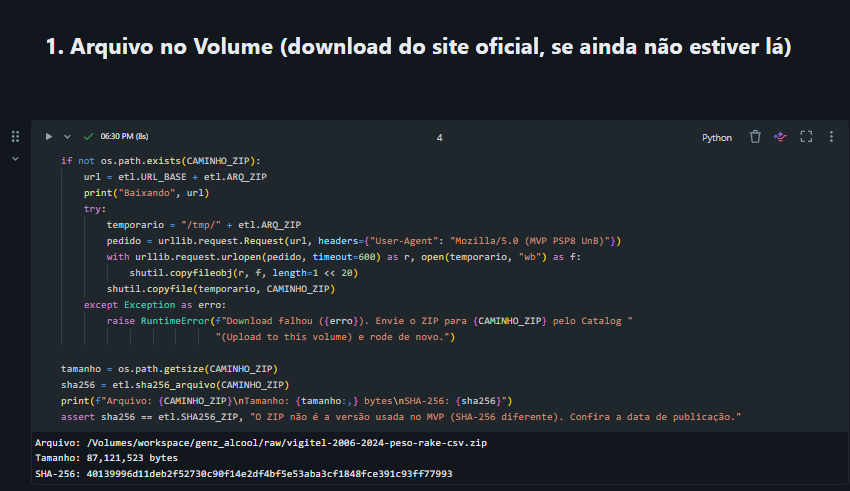

O log da coleta (arquivo, caminho no Volume, data, bytes, SHA-256, fonte e licença) está em [06](evidencias/databricks/06_nb01_verificacao_log_coleta.png). A bronze foi gravada em lotes de 20 mil linhas ([04](evidencias/databricks/04_nb01_bronze_lotes_inicio.png) e [05](evidencias/databricks/05_nb01_bronze_lotes_fim.png)) e ficou com as mesmas 833.217 linhas do CSV ([07](evidencias/databricks/07_nb01_verificacao_bronze_833217.png)).

## 4. Estrutura do repositório

| Pasta ou arquivo | Conteúdo |
|---|---|
| `notebooks/01` a `05` | pipeline do Databricks: coleta e bronze, silver, gold (estrela), qualidade, análise |
| `notebooks/06_correlatos.py` | análise complementar: o que anda junto com o consumo abusivo (seção 9.2) |
| `notebooks/aed/` | notebooks de análise exploratória (v1 a v3; o v3 roda no Colab e no Databricks), o gerador deles e as tabelas de saída |
| `scripts/` | `vigitel_etl.py` (regras de ETL), `qualidade.py`, `analise.py`, `graficos.py`, `gerar_catalogo.py` |
| `tests/rodar_local.py` | simulador local (duckdb) que executa os notebooks 01 a 06 sem cluster |
| `catalogo/` | catálogo de dados (`.md` e `.csv`) e modelo estrela |
| `DECISOES_TRATAMENTO.md` | decisões D1 a D14, alternativas e motivos |
| `Relatório de Análise Exploratória de Dados v3.md` | exploração e decisões, com os motivos do autor (a v2 fica como registro) |
| `POSSIVEIS_DESCOBERTAS.md` | achados preliminares a confirmar |
| `PENDENCIAS_AED.md` | comentários do autor sobre a exploração, acumulados e implementados por versão |
| `resultados/figuras/`, `figuras_relatorio_v2/` | figuras da análise (f01 a f14) e do relatório de exploração v2 |
| `evidencias/` | capturas da execução no Databricks (`databricks/`, 01 a 25, de 21/10/2026) e registros da execução local |
| `apresentacao/` | apresentação dos resultados (`.pptx` e `.pdf`) e o script que a gera |
| `docs_fonte/` | documentação oficial do Vigitel: dicionário, orientações, nota metodológica e relatórios |
| `LICENSE` | licença do código (MIT) e registro da licença dos dados |

Os microdados brutos (`dados/raw/`) não são versionados, por causa da licença e do tamanho (577 MB descompactados): o notebook 01 baixa o arquivo do site oficial e confere o SHA-256.

## 5. Como reproduzir

**No Databricks (evidência exigida):**
1. *Workspace > Create > Git folder* com este repositório, <https://github.com/guilhermeafcunha/mvp-genz-alcool> (ou importe a pasta inteira, mantendo `notebooks/` e `scripts/` lado a lado: os notebooks localizam `scripts/` sozinhos).
2. Execute `notebooks/01_coleta_bronze` a `05_analise_hipoteses`, em ordem. O 01 cria o esquema e o Volume e baixa o ZIP; se não houver acesso à internet, envie o ZIP para `/Volumes/workspace/genz_alcool/raw/` e execute de novo.
3. Tire os screenshots das células "Verificação" de cada notebook e do Volume (pasta `evidencias/`).

**Exploração no Colab:** abra `notebooks/aed/MVP_GenZ_Alcool_01_AED_v3.ipynb` e use *Executar tudo*.

**Teste local:** `pip install -r requirements.txt`, coloque o ZIP em `dados/raw/` e rode `python tests/rodar_local.py dados/raw/vigitel-2006-2024-peso-rake-csv.zip`.

## 6. Modelagem

Esquema estrela, com a fato no grão de entrevista (615.877 linhas, edições de 2010 a 2024) e seis dimensões: edição, capital, geração, escolaridade, faixa etária e sexo. Diagrama e motivo em [`catalogo/modelo_estrela.md`](catalogo/modelo_estrela.md); dicionário completo, com tipo, domínio, obrigatoriedade e linhagem de cada atributo, em [`catalogo/catalogo_de_dados.md`](catalogo/catalogo_de_dados.md).

**Evidência da carga na gold.** No Databricks, o notebook 03 descreve as tabelas do modelo ([11](evidencias/databricks/11_nb03_cabecalho_estrela.png)), confere a integridade referencial (615.877 linhas na fato; 14 edições, 27 capitais, 4 gerações, 3 escolaridades, 6 faixas etárias e 2 sexos nas dimensões) e grava cada tabela com seu comentário ([12](evidencias/databricks/12_nb03_integridade_referencial.png)). Ao fim da execução, o esquema `genz_alcool` tem 26 tabelas Delta: bronze, silver, fato, dimensões, qualidade e resultados ([13](evidencias/databricks/13_nb03_tabelas_1.png) e [14](evidencias/databricks/14_nb03_tabelas_2.png)). A junção da fato com as seis dimensões reproduz as linhas da silver, sem perda nem duplicação:

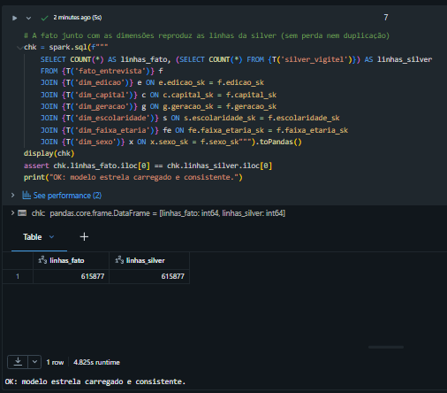

A captura [16](evidencias/databricks/16_nb03_consulta_exemplo.png) mostra uma consulta de exemplo sobre o modelo (consumo abusivo aos 18-24 por geração e sexo). Ela usa a média ponderada simples, **sem** a padronização pela idade (D14), e por isso os valores diferem dos da seção 9; serve para demonstrar o modelo, não como resultado.

## 7. ETL e regras de negócio

As regras S1 a S11 da silver aplicam as decisões de tratamento tomadas pelo autor depois da análise exploratória (detalhe e motivos em `DECISOES_TRATAMENTO.md` e no relatório v3, seção 6):

| Regra | O que faz | Decisão |
|---|---|---|
| S1 | só edições de 2010 em diante, filtro pelo ano | D5 |
| S2 | `entrevista_id` = edição + linha do arquivo | D10 |
| S3 | marcadores de pandemia (2020-2021) e de filtro novo (2024) | D11, D13 |
| S4 | capital, UF e região derivadas do código da capital | D12 |
| S5 | modo de coleta (fixo até 2021) | D2, D13 |
| S6 | idade, faixa etária e sexo com rótulos | — |
| S7 | ano de nascimento e geração | D2 |
| S8 | escolaridade oficial e marcador de escolaridade estimada | D7, D8 |
| S9 | indicador oficial de consumo abusivo (`alcabu`) | D6 |
| S10 | bebe ao menos 1x por mês (`q36`) e "costuma beber" (`q35`, só conferência até 2023) | D6 |
| S11 | peso normalizado para somar 1 por edição | D4 |
| — | texto livre e as demais colunas ficam só na bronze | D12 |

A edição de 2022 não existe e não é imputada (D1).

**Evidência da transformação.** O notebook 02 traz a tabela das regras S1 a S11 com as decisões e os motivos ([08](evidencias/databricks/08_nb02_regras_silver.png)). Na silver persistida no Databricks, os jovens de 18 a 24 anos se distribuem como no desenho da D2: 23.805 millennials (edições de 2010 a 2016), 26.745 zillennials (2011 a 2021) e 10.485 da geração Z (2017 a 2024) ([09](evidencias/databricks/09_nb02_verificacao_geracoes.png)). O modo de coleta é só fixo até 2021, há fixo e celular em 2023 e 2024, e o peso normalizado soma 1 em cada edição (S5 e S11; [10](evidencias/databricks/10_nb02_verificacao_modo_peso.png)).

## 8. Qualidade dos dados

O notebook 04 verifica 16 regras em seis dimensões (completude, unicidade, consistência, conformidade, acurácia e atualidade; cabeçalho em [17](evidencias/databricks/17_nb04_cabecalho.png)). Na execução local e no Databricks, todas as regras de verificação passaram (zero violações): bronze com as mesmas 833.217 linhas do CSV, silver com todas as 615.877 entrevistas de 2010 em diante, chave única, faixa etária e escolaridade coerentes, pulo das perguntas de doses conferido em 100% dos casos e peso normalizado somando 1 em cada edição. Registros informativos: 7.477 escolaridades estimadas pelo Ministério (D8), 35.280 entrevistas por celular (D2, D13) e a chave oficial repetida em 86.001 registros (D10).

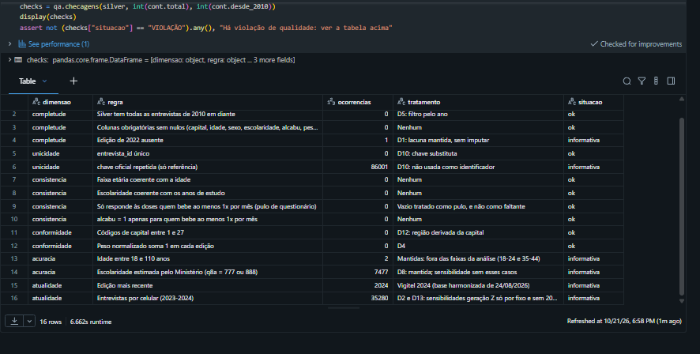

Além das regras, o perfil dos 28 atributos da silver (tipo, nulos, % de nulos, valores distintos, mínimo, máximo e exemplos) está em [19](evidencias/databricks/19_nb04_perfil_atributos_1.png) e [20](evidencias/databricks/20_nb04_perfil_atributos_2.png). Os únicos atributos com nulos são a chave oficial (só existe em parte dos anos, D10), a frequência de consumo (pulo de quem não bebe) e a `costuma_beber_q35` (não publicada em 2024, D6).

## 9. Resultados

Os números abaixo foram obtidos na execução local (`evidencias/log_execucao_local_pipeline.txt`) e **confirmados na execução no Databricks** de 21/10/2026, que deu os mesmos valores. O notebook 05 ([21](evidencias/databricks/21_nb05_cabecalho.png)) gravou as tabelas `res_p1` a `res_p5`, `res_sensibilidades` e `res_veredito` ([14](evidencias/databricks/14_nb03_tabelas_2.png)) e gerou as figuras f01 e f02 ([22](evidencias/databricks/22_nb05_figuras_f01_f02.png)); as capturas de cada pergunta estão citadas nos parágrafos abaixo. Prevalências ponderadas, aos 18-24 anos, **padronizadas pela idade simples** (seção 1.3 e D14); IC 95% aproximado (Kish). Diferenças com \* têm intervalo que não inclui o zero.

**Revisão de 18/10/2026.** A primeira versão destes resultados comparava as gerações sem padronizar pela idade e mostrava uma queda total de −2,1 p.p. Essa queda vinha em boa parte de a geração Z ter sido observada mais nova: na mesma idade, ela desaparece (figura f03a e última linha da f11). Os números sem padronizar ficam na tabela para mostrar o tamanho do viés.

| | Millennials (1986-92) | Zillennials (1993-98) | Geração Z (1999-2006) | Geração Z − millennials | Sem padronizar (versão anterior) |
|---|---|---|---|---|---|
| Total | 21,1% | 22,2% | 22,3% | +1,1 p.p. (−1,1 a +3,3) | −2,1 p.p. (−3,9 a −0,2)\* |
| Homens | 28,1% | 26,7% | 24,0% | −4,0 p.p. (−7,3 a −0,8)\* | −8,1 p.p. (−10,9 a −5,3)\* |
| Mulheres | 14,1% | 17,8% | 20,5% | +6,4 p.p. (+3,6 a +9,2)\* | +3,9 p.p. (+1,5 a +6,3)\* |

**Cada geração contra a anterior (P1).** Millennials → zillennials: +1,1 p.p. no total (−0,4 a +2,5), −1,4 nos homens (n.s.) e +3,8 nas mulheres (+2,0 a +5,6)\*. Zillennials → geração Z: 0,0 no total, −2,6 nos homens e +2,6 nas mulheres, nenhuma significativa. Padronizando também pela escolaridade dos millennials (D7), o total fica em 21,2%, 22,6% e 22,7%: a mudança de escolaridade não explica a diferença. No Databricks: tabelas `res_p1_geracao` e `res_p1_diferencas` abaixo, e a figura f03 em [27](evidencias/databricks/27_nb05_p1_figura_f03.png).

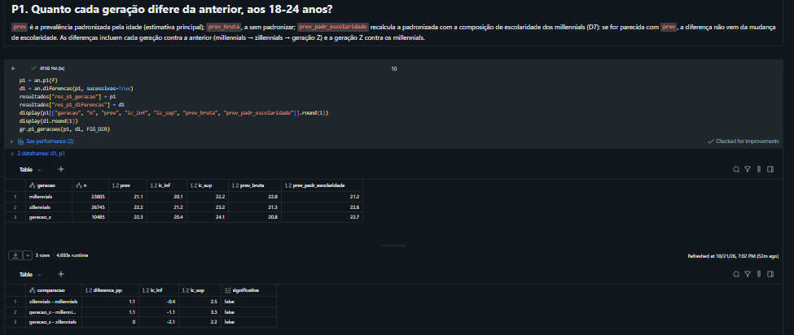

**Por escolaridade (P2).** Geração Z − millennials: +0,6 p.p. (0 a 8 anos de estudo), +2,0 (9 a 11) e +1,2 (12 ou mais), nenhuma significativa. Não há sinal de queda concentrada nos mais escolarizados, mas também não há queda em nenhuma faixa. Sem os casos de escolaridade estimada (D8), as diferenças praticamente não mudam. No Databricks: tabelas `res_p2_diferencas` e decomposição por escolaridade em [29](evidencias/databricks/29_nb05_p2_tabelas.png); figura f06 em [30](evidencias/databricks/30_nb05_p2_heatmap_f06.png).

**Geração ou época (P3).** Nas mesmas edições, os adultos de 35 a 44 anos subiram 3,8 p.p. (19,2% → 23,0%) e os jovens, 1,1 p.p.: a diferença das diferenças é de −2,7 p.p. (−5,1 a −0,3)\*. Os jovens não beberam menos em termos absolutos, mas subiram menos que a tendência da época. Ao envelhecer, os homens zillennials ficam cerca de 1,4 p.p. abaixo dos millennials tanto aos 18-24 quanto aos 25-29 (curvas paralelas); as mulheres zillennials ficam acima nas duas faixas. A leitura anterior de "adiamento" vinha do viés de idade e não se sustenta. No Databricks: período e diferença das diferenças em [31](evidencias/databricks/31_nb05_p3_periodo.png) e [32](evidencias/databricks/32_nb05_p3_diferenca_f07.png) (com a f07); envelhecimento (f08) em [33](evidencias/databricks/33_nb05_p3_envelhecimento_f08.png).

**Por sexo (P4).** Diferenças da tabela acima por sexo, com a figura f04, no Databricks: [34](evidencias/databricks/34_nb05_p4_sexos_f04.png). Homens: −4,0 p.p. da geração Z para os millennials (−7,3 a −0,8)\*; mulheres: +6,4 p.p. (+3,6 a +9,2)\*.

**Por quê (decomposição, D6).** Homens: a proporção que bebe ao menos uma vez por mês quase não muda (43% → 41%); o que cai é o exagero entre os que bebem (65% → 58%). Mulheres: mais bebem (25% → 35%), e o exagero entre as que bebem fica estável (56% → 58%). No Databricks: tabela `res_p1_decomposicao` e figura f05 em [28](evidencias/databricks/28_nb05_p1_decomposicao_f05.png).

**Capitais (P5).** Só Aracaju tem diferença fora da margem (−6,1 p.p.); com 27 capitais, cerca de uma é esperada só pelo acaso. Nenhuma região tem diferença significativa (de −0,5 p.p. no Norte a +4,5 no Sul). A maioria das capitais do Sul e do Sudeste (exceto o Rio de Janeiro) sobe e a maioria das do Nordeste (exceto Salvador) cai, mas dentro da margem. No Databricks: regiões em [35](evidencias/databricks/35_nb05_p5_regioes.png); capitais com o mapa f09 em [36](evidencias/databricks/36_nb05_p5_mapa_f09.png); margens por capital (f10) em [37](evidencias/databricks/37_nb05_p5_capitais_f10.png).

**Robustez.** As mulheres sobem em cinco dos seis cenários com significância (de +5,1 a +8,1 p.p.); só na geração Z por telefone fixo (+2,7) o intervalo inclui o zero. A queda dos homens (de −2,4 a −4,1 p.p.) perde a significância em três cenários: só 18 a 21 anos, sem 2024 e geração Z só por fixo. No Databricks: tabelas de `res_sensibilidades` (diferença e significância por cenário) em [38](evidencias/databricks/38_nb05_sensibilidades_veredito.png).

**Veredito pelos critérios da seção 1.2:** (a) **não atendido**: na mesma idade, a geração Z não tem prevalência menor que a dos millennials (+1,1 p.p., n.s.); (b) **não atendido**: os homens caem e as mulheres sobem, e nenhuma faixa de escolaridade cai; (c) atendido: os jovens subiram menos que os adultos de 35 a 44 no mesmo período. **A hipótese é refutada no que tem de central:** a geração Z não bebe em excesso menos que os millennials na mesma idade. O que existe é uma convergência entre os sexos (de 14 para 3,5 p.p.), com uma queda masculina moderada e pouco robusta e uma alta feminina robusta, e um consumo jovem que cresce menos que o dos adultos. Na versão sem padronizar, o critério (a) era atendido e a hipótese era "parcialmente refutada"; a mudança vem só da correção do método, com os critérios inalterados.

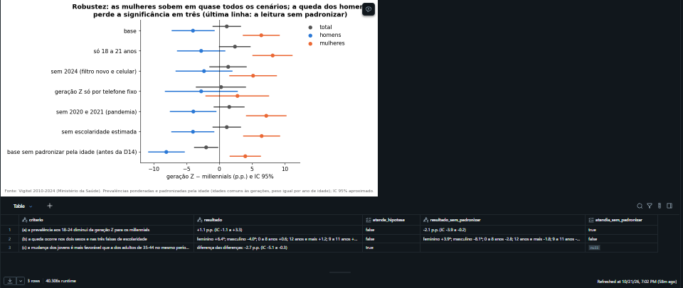

### 9.1 Figuras (em `resultados/figuras/`, na ordem da apresentação)

| # | Figura | Mensagem |
|---|---|---|
| f01 | 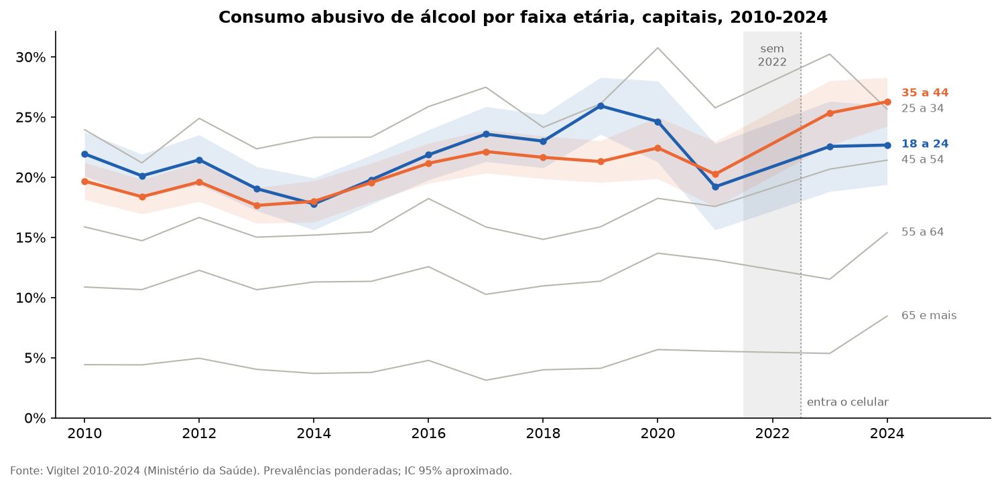 | Série 2010-2024 por faixa etária, com as rupturas (sem 2022, entrada do celular) |
| f02 | 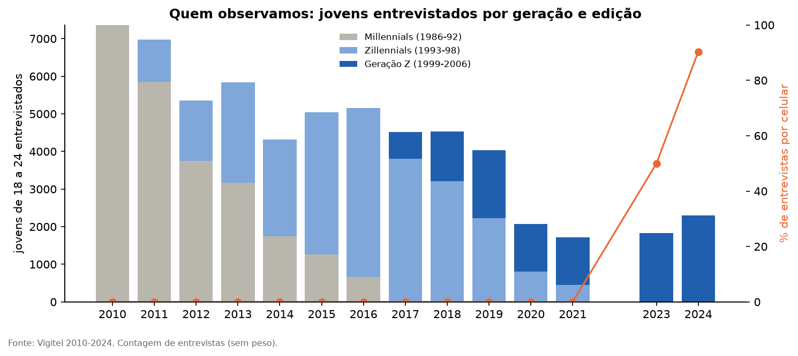 | Quem observamos: jovens entrevistados por geração e edição, e a % de celular |
| f03a | 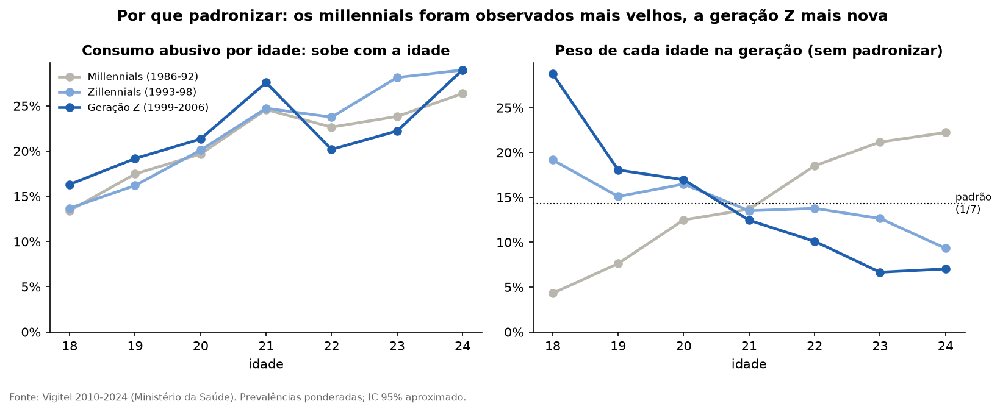 | Por que padronizar: o consumo sobe com a idade, e cada geração foi observada em idades diferentes (D14) |
| f03 | 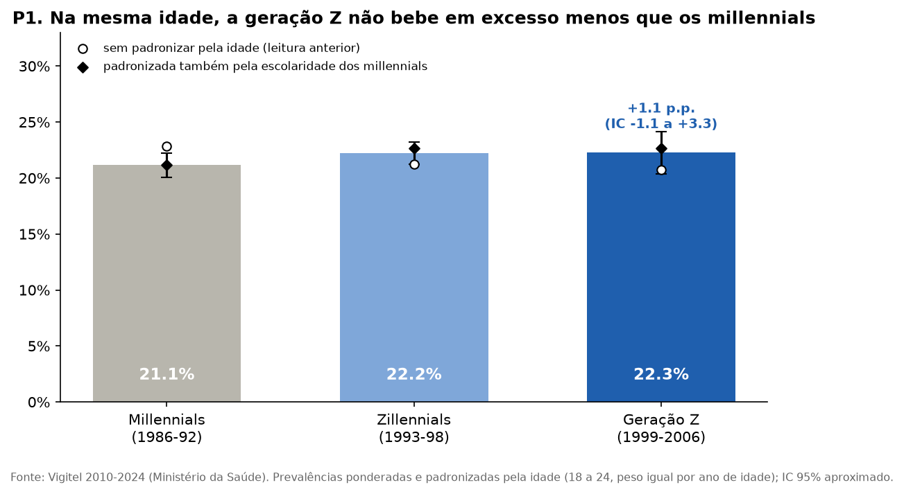 | P1: na mesma idade, a geração Z não bebe em excesso menos que os millennials (padronizada, sem padronizar e padronizada também pela escolaridade) |
| f04 | 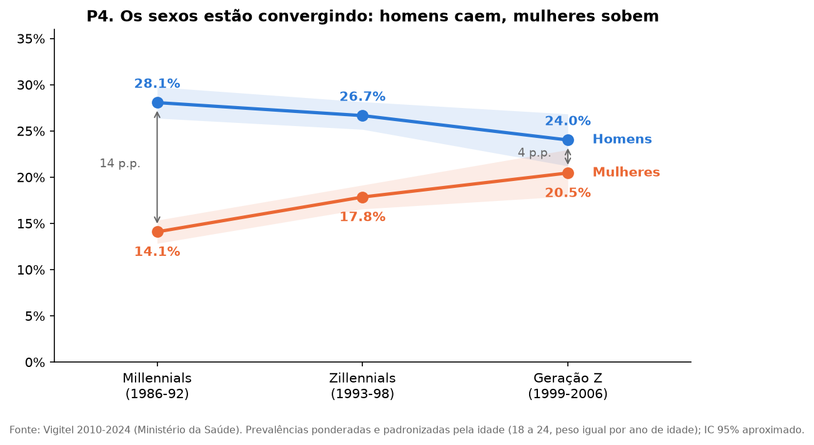 | P4: os sexos convergem (distância de 14 para 3,5 p.p.) |
| f05 | 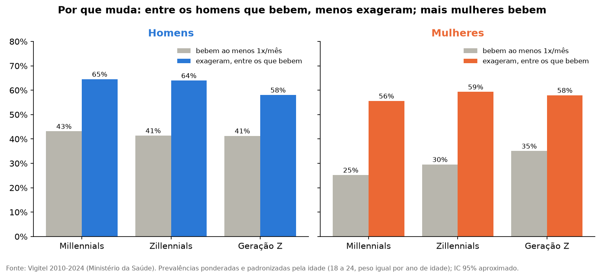 | Por que muda: quem bebe x quanto exagera, por sexo |
| f06 | 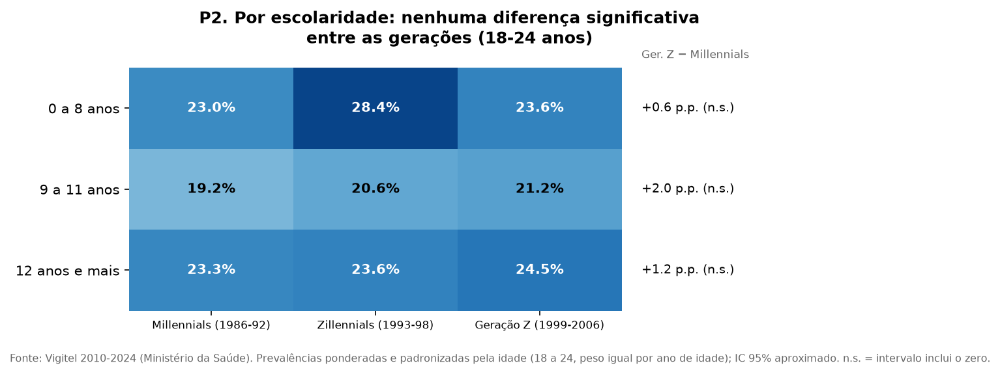 | P2: por escolaridade, nenhuma diferença significativa |
| f07 | 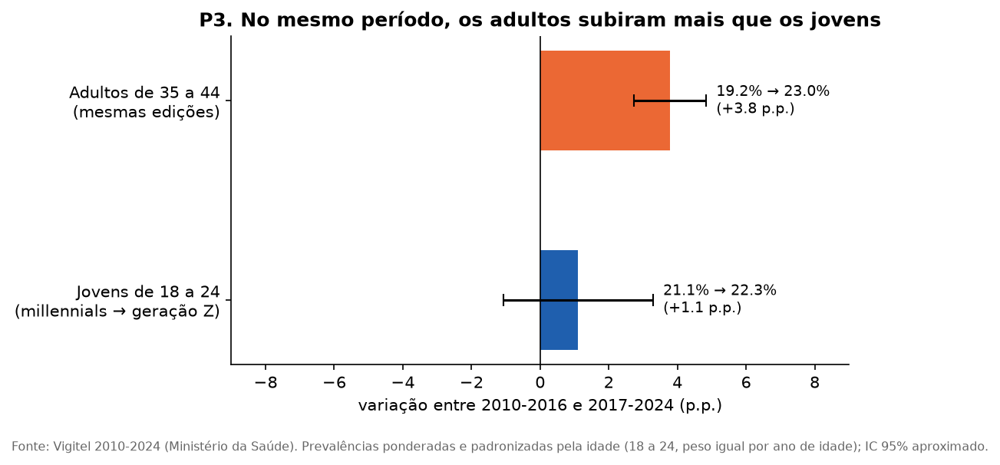 | P3: no mesmo período, os adultos de 35-44 subiram mais que os jovens |
| f08 | 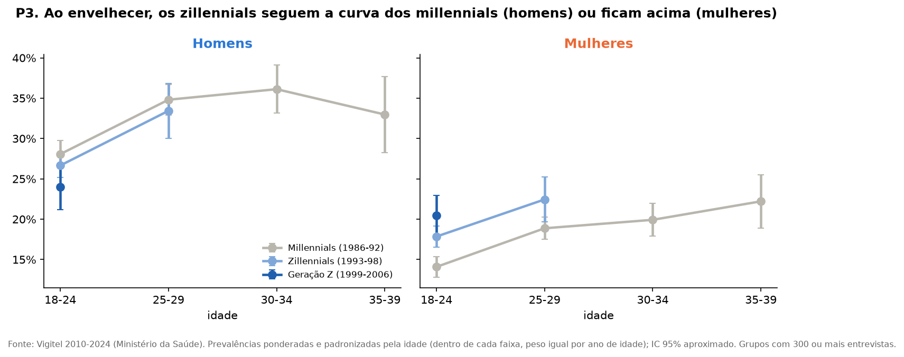 | P3: cada geração ao envelhecer (curvas paralelas nos homens) |
| f09 | 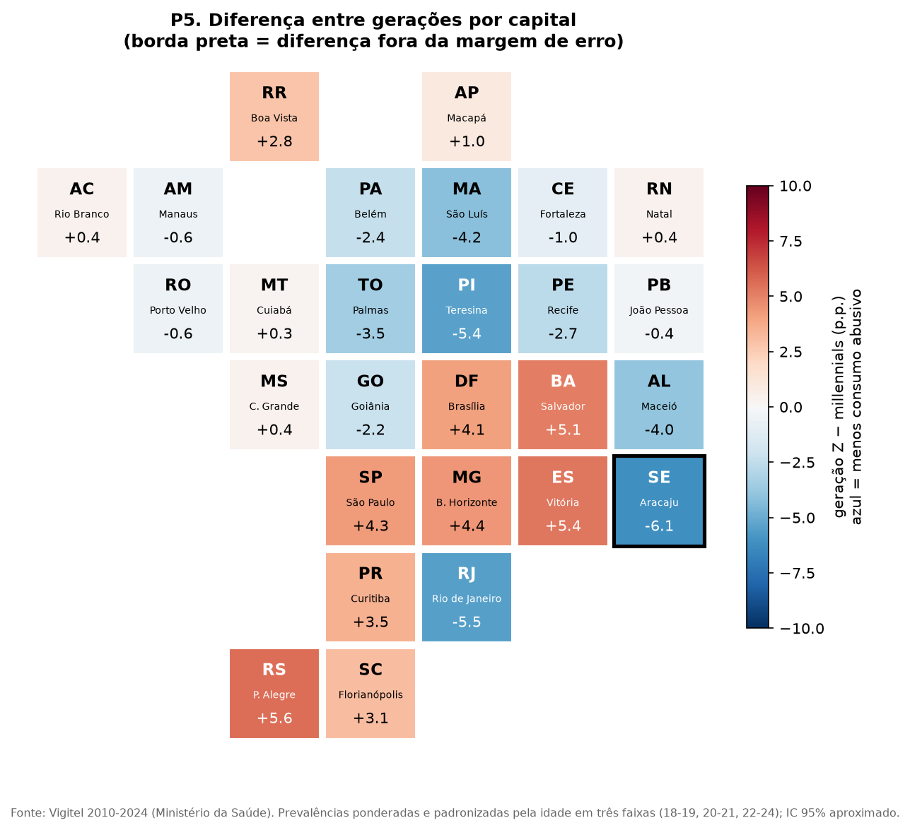 | P5: mapa das capitais |
| f10 | 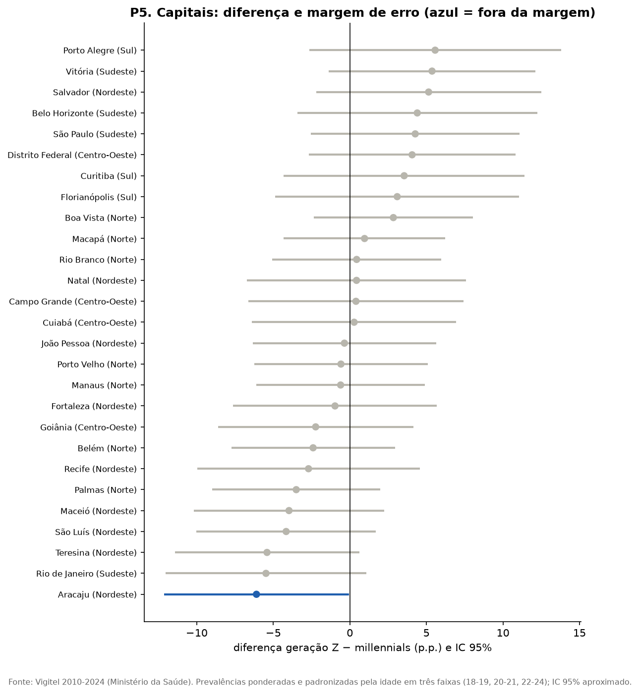 | P5: diferença e margem de erro por capital |
| f11 | 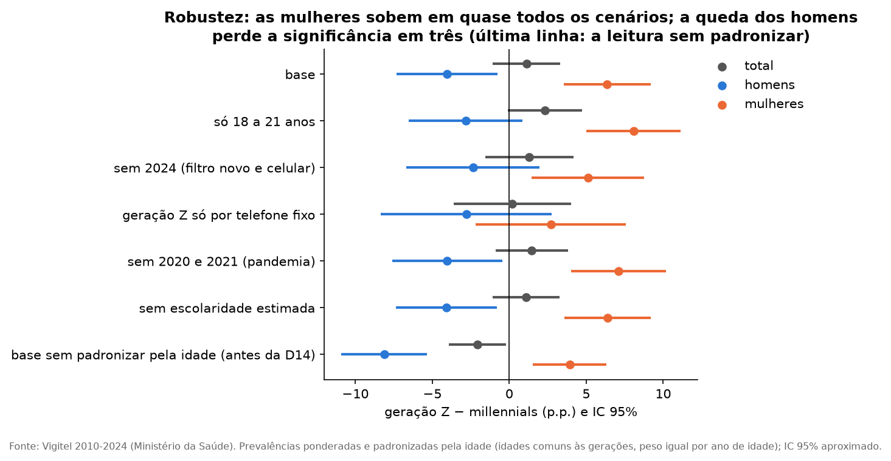 | Robustez: as seis sensibilidades e, na última linha, a leitura sem padronizar |
| f12 | 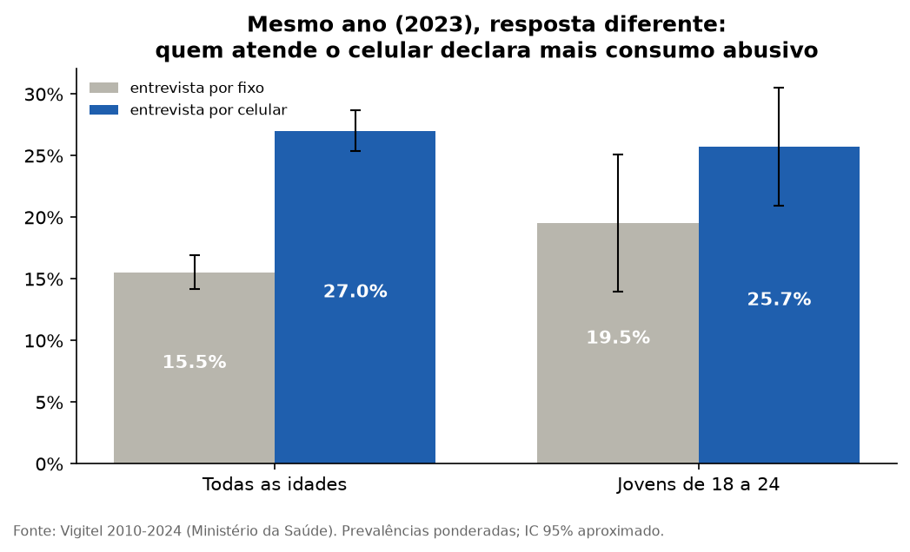 | Limitação: fixo x celular no mesmo ano |
| f13 | 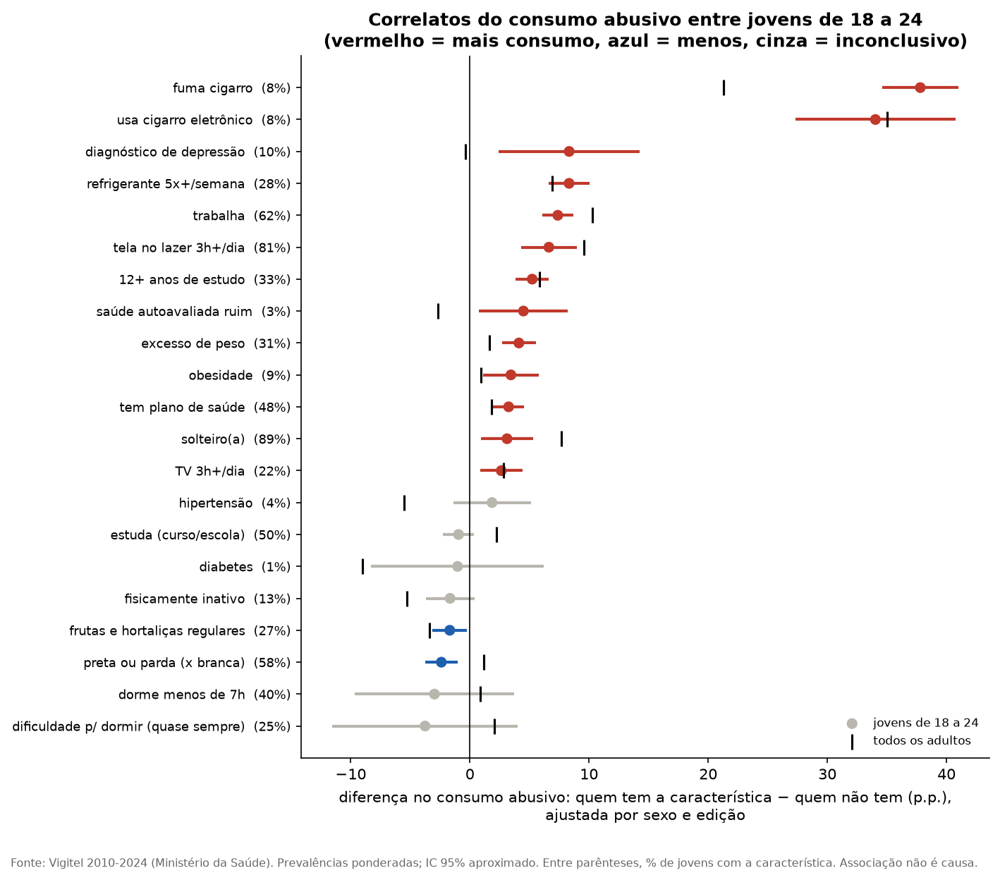 | Correlatos do consumo abusivo (notebook 06) |
| f14 | 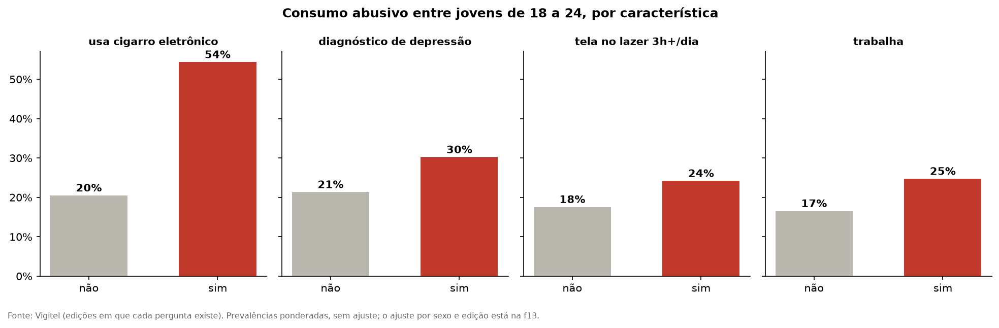 | Destaques dos correlatos |

### 9.2 Análise complementar: o que anda junto com o consumo abusivo (notebook 06)

Entre jovens de 18 a 24, diferença de consumo abusivo entre quem tem e quem não tem cada característica, ajustada por sexo e edição. Classificação de expectativa feita antes de olhar os dados. Execução no Databricks: cabeçalho e cuidados de leitura em [23](evidencias/databricks/23_nb06_cabecalho.png), figura dos correlatos (f13) em [24](evidencias/databricks/24_nb06_f13_correlatos.png) e destaques (f14) com a gravação das tabelas `res_correlatos` e `res_correlatos_destaque` em [25](evidencias/databricks/25_nb06_f14_destaques.png).

| Característica | % dos jovens | Diferença ajustada (IC 95%) | Todos os adultos | Leitura |
|---|---|---|---|---|
| Fuma cigarro | 8% | +37,8 p.p. (+34,6 a +41,0) | +21,3 | Esperado (uso conjunto); mais forte nos jovens |
| Usa cigarro eletrônico (2019+) | 8% | +34,0 p.p. (+27,3 a +40,8) | +35,0 | Esperado; metade dos jovens que usam vape bebe em excesso |
| Diagnóstico de depressão (2020+) | 10% | +8,3 p.p. (+2,4 a +14,2) | −0,4 | **Só entre os jovens**; não passa no critério rígido (Bonferroni) |
| Refrigerante 5x+/semana | 28% | +8,3 p.p. (+6,6 a +10,0) | +6,9 | Inesperado; passa no critério rígido |
| Trabalha | 62% | +7,4 p.p. (+6,1 a +8,7) | +10,3 | Renda própria |
| Tela no lazer 3h+/dia (2016+) | 81% | +6,6 p.p. (+4,3 a +9,0) | +9,6 | **Contraria a ideia** de que o jovem "fica no celular em vez de sair para beber" |
| 12+ anos de estudo | 33% | +5,2 p.p. (+3,8 a +6,6) | +5,8 | Mais escolaridade, mais consumo abusivo |
| Preta ou parda (x branca) | 58% | −2,4 p.p. (−3,8 a −1,0) | +1,2 | Inesperado: só entre os jovens |
| Sono curto, dificuldade para dormir (2024) | 25-40% | n.s. | — | Só 2024, amostra pequena |
| Hipertensão, diabetes, inatividade | — | n.s. | — | Improváveis, confirmados como sem associação |

**Cuidados:** associação não é causa e pode ser nos dois sentidos; com 21 testes, cerca de 1 "significativo" pode ser acaso, e por isso a tabela completa (`res_correlatos`) traz também o critério de Bonferroni; o ajuste é só por sexo e edição. Apostas online (pergunta nova de 2024) não puderam ser testadas: a resposta não foi publicada na base.

### 9.3 Discussão por pergunta

O ponto de partida deste trabalho foram as notícias de mercado afirmando que a geração Z bebe menos e que isso estaria dando prejuízo à indústria de bebidas alcoólicas. Todos temos percepções pessoais sobre o assunto; a intenção aqui foi verificar a afirmação com dados e, no caminho, conhecer o que mais se relaciona com o consumo dos jovens. A discussão abaixo liga cada resposta à decisão que ela apoia e diz até onde as limitações da seção 11.2 permitem ir.

**P1. A geração Z bebe em excesso menos que as anteriores, na mesma idade?** Não, nas capitais brasileiras. Padronizada pela idade, a prevalência é praticamente a mesma nas três gerações (21,1%, 22,2% e 22,3%), e a diferença entre a geração Z e os millennials (+1,1 p.p.) não é significativa. A primeira versão da análise mostrava uma queda de 2,1 p.p., e ela vinha do desenho: na janela 2010-2024, os millennials foram observados sobretudo aos 22-24 anos e a geração Z sobretudo aos 18-20, e o consumo abusivo sobe com a idade (f03a). Comparar públicos com composições diferentes sem padronizar produz diferenças que não são de comportamento. Esse é, talvez, o principal aprendizado do trabalho: a mesma base, com o mesmo indicador, levou a vereditos opostos conforme o método. Para o decisor, a consequência é direta: a premissa que motiva o investimento ("o jovem bebe menos") não se confirma para o consumo abusivo no Brasil. Duas ressalvas impedem afirmar o contrário com força: o indicador mede quem bebe em excesso, não quanto se bebe (um jovem pode exagerar com a mesma frequência e beber menos no total), e o consumo é declarado por telefone.

**P4. A diferença é igual entre homens e mulheres?** Não, e é aqui que está o achado mais forte. O total sem diferença esconde dois movimentos opostos que se cancelam: os homens caem 4,0 p.p. e as mulheres sobem 6,4 p.p., e a distância entre os sexos encolhe de 14 para 3,5 p.p. (f04). Os dois movimentos têm mecanismos diferentes (f05): entre os homens, a proporção que bebe quase não muda, mas cai o exagero entre os que bebem (de 65% para 58%), o que se parece com moderação; entre as mulheres, mais jovens passam a beber (de 25% para 35%), e o exagero entre as que bebem fica estável. As duas conclusões não têm a mesma solidez: a alta feminina se mantém em cinco dos seis cenários de robustez, enquanto a queda masculina perde a significância em três deles, inclusive quando a geração Z é comparada só pelo telefone fixo (f11). Há ainda uma limitação que pesa justamente aqui: se a norma social sobre o beber feminino mudou entre gerações, parte da alta pode ser de declaração (as jovens se sentem mais à vontade para relatar), e não só de comportamento. Para o negócio, a mensagem é que "o jovem" não é um público único: há uma história de moderação masculina, ainda frágil, e uma de entrada feminina no consumo, mais sólida.

**P2. A diferença ocorre em todas as faixas de escolaridade?** Nenhuma faixa de escolaridade cai, e as diferenças entre as faixas não são significativas (f06). Não há, portanto, sinal de uma mudança restrita aos mais escolarizados, que justificaria um produto de nicho premium. Mas também não há queda generalizada que sustente um produto de massa com base nessa tendência. A resposta vale para escolaridade, usada como aproximação de classe social; aos 18-24 anos muitos jovens ainda estão estudando, e a renda não foi medida.

**P3. A diferença é da geração ou da época?** No mesmo período, os adultos de 35 a 44 anos subiram 3,8 p.p. e os jovens, 1,1 p.p.; a diferença das diferenças (−2,7 p.p.) é significativa (f07). Os jovens não beberam menos em termos absolutos, mas ficaram abaixo da tendência da época, que foi de alta. Ao envelhecer, os homens zillennials mantêm a mesma distância dos millennials aos 18-24 e aos 25-29 anos (curvas paralelas, f08), o que é compatível com uma mudança que acompanha a geração, e não com um simples adiamento. A geração Z, porém, ainda não chegou aos 25-29 anos dentro da série, e a comparação com os adultos controla, mas não separa por completo, idade, período e geração.

**P5. Quais capitais concentram as maiores diferenças?** Só Aracaju tem diferença fora da margem de erro (−6,1 p.p.), o que é compatível com o acaso em 27 comparações (f09, f10). Há um desenho regional (a maioria das capitais do Sul e do Sudeste sobe, a maioria das do Nordeste cai), mas dentro da margem. Com as amostras por capital e geração disponíveis, os dados não sustentam uma priorização regional de lançamento.

**Correlatos (notebook 06).** A análise complementar abre mais perguntas do que responde, e isso é útil. Entre os jovens que usam cigarro eletrônico, 54% bebem em excesso, contra 20% dos que não usam (f14); o uso de tela por 3 horas ou mais no lazer anda junto com mais consumo, e não menos, ao contrário da ideia de que o jovem "fica no celular em vez de sair para beber"; o diagnóstico de depressão se associa ao consumo abusivo só entre os jovens (f13). São associações ajustadas apenas por sexo e edição, que não indicam causa nem direção. Cada uma delas pode virar uma investigação própria, com a metodologia adequada (controle de mais fatores, critério para muitos testes e, idealmente, dados que acompanhem as mesmas pessoas no tempo).

### 9.4 Discussão geral: o que os dados dizem sobre o problema

A pergunta de partida era se a geração Z bebe menos e se essa mudança vale para todas as classes sociais. Para o consumo abusivo nas capitais brasileiras, a resposta é que **a geração Z não bebe em excesso menos que os millennials na mesma idade**. O que mudou foi a composição: os homens jovens moderam um pouco o exagero, as jovens bebem mais, e o consumo jovem cresce menos que o dos adultos. A hipótese do trabalho foi refutada no que tem de central, e esse resultado negativo é, em si, informação para o decisor: ele diz que a narrativa de mercado não pode ser transportada para o Brasil sem verificação.

Para as duas decisões da seção 1.1:

1. **Nicho ou massa.** A pergunta pressupunha uma redução do consumo, cuja distribuição entre as classes definiria o posicionamento. Como a redução não aparece em nenhuma faixa de escolaridade, os dados não sustentam nenhum dos dois posicionamentos com base na tendência. O que eles mostram, a moderação entre os homens que bebem, aponta mais para produtos de baixo teor e de moderação do que para a substituição do álcool, mas esse sinal ainda é frágil.
2. **Estrutural ou fase de idade.** As curvas paralelas dos homens millennials e zillennials sugerem uma mudança que acompanha a geração, e não um adiamento. A geração Z, porém, ainda não pode ser acompanhada ao envelhecer; a resposta para ela fica para as próximas edições do Vigitel.

**Recomendação do autor ao decisor: esperar mais dados antes de um investimento de grande porte.** O custo de erro descrito na seção 1.1 (posicionar como tendência ampla algo que não se confirma) é exatamente o risco de agir apenas com a narrativa de mercado. Antes, recomendo: (a) **confirmar com outras fontes além de pesquisa e autorrelato**, como dados de vendas e de volume (varejo, a POF do IBGE e os dados da própria empresa), que medem consumo efetivo e não dependem da declaração do entrevistado; (b) **investigar melhor a relação entre o consumo abusivo e a quantidade consumida**, porque o Vigitel mede a ocorrência do exagero, não o volume: uma prevalência estável com menos exagero entre os homens que bebem pode coexistir com menor volume total, e é o volume que define o tamanho do mercado; e (c) **olhar para o público feminino jovem**, onde está a mudança mais robusta da série, tanto como oportunidade de mercado quanto como alerta de saúde pública. Para a política de saúde, o mesmo achado indica que as ações de prevenção ao consumo abusivo entre jovens não podem mais tomar o público masculino como o único foco.

Por fim, as conclusões valem dentro dos limites declarados na seção 11.2: só capitais, consumo declarado por telefone, prevalência no lugar de volume, escolaridade no lugar de renda e uma mudança de modo de coleta (entrada do celular) que coincide com a geração Z. Nenhuma delas invalida o resultado central, mas todas recomendam cautela na passagem dos números para a decisão.

## 10. Situação do projeto e próximos passos

### 10.1 O que já foi feito

| Data | Etapa | Onde está |
|---|---|---|
| 16/10/2026 | Coleta do arquivo oficial (87 MB, SHA-256 conferido) e leitura da documentação do Vigitel | seção 3; `docs_fonte/` |
| 16/10/2026 | Análise exploratória v1 e v2: mapa de vazios em três categorias, pesos, mudanças de método (2010, celular, 2024) e prévia das perguntas | `notebooks/aed/`; *Relatório de Análise Exploratória de Dados v2* |
| 16/10/2026 | Objetivo reescrito por geração (versão 2), mantendo a versão 1 no Anexo A | seção 1 |
| 16/10/2026 | Decisões de tratamento D1 a D13, com alternativas e motivos | `DECISOES_TRATAMENTO.md` |
| 16/10/2026 | Pipeline do Databricks: notebooks 01 a 05, módulos de ETL, qualidade e análise, simulador local | `notebooks/`, `scripts/`, `tests/` |
| 16/10/2026 | Catálogo de dados (tipo, domínio, obrigatoriedade e linhagem) e modelo estrela | `catalogo/` |
| 16 e 17/10/2026 | Análise exploratória v3, que já aplica as decisões; achados preliminares; análise complementar dos correlatos (notebook 06) | `notebooks/aed/`; *Relatório v3*; `POSSIVEIS_DESCOBERTAS.md` |
| 17/10/2026 | Primeira versão da apresentação dos resultados | `apresentacao/` |
| 18/10/2026 | Decisão D14: comparação entre gerações padronizada pela idade simples. Resultados, figuras, registros de execução e apresentação refeitos; a hipótese passa de "parcialmente refutada" a "refutada no que tem de central" | seções 1.3 e 9; `resultados/figuras/`; `evidencias/` |
| 21/10/2026 | Publicação no GitHub, `LICENSE` e PDF da apresentação gerado de novo a partir da versão revisada | este repositório |

### 10.2 O que falta (checklist do enunciado)

- [x] Objetivo e perguntas de negócio documentados e íntegros, inclusive a formulação anterior (seção 1 e Anexo A).
- [x] Origem, licença e data de coleta registradas (seção 3 e `LICENSE`).
- [x] Dados persistidos na plataforma de nuvem: notebooks 01 a 06 executados no Databricks Free Edition em 21/10/2026, com 26 tabelas Delta (seções 3, 6, 7 e 8).
- [x] Modelo de dados descrito e catálogo com domínios e linhagem (seção 6 e `catalogo/`).
- [x] Transformação e carga documentadas, com as regras de negócio explícitas (seção 7).
- [x] Análise de qualidade em seis dimensões (seção 8), a confirmar na nuvem.
- [x] Resposta a cada pergunta, com figura e discussão (seção 9), a confirmar na nuvem.
- [x] Discussão por pergunta e discussão geral conectando as respostas às duas decisões de negócio (seções 9.3 e 9.4).
- [x] Autoavaliação: perguntas respondidas e não respondidas, limitações, o que faria diferente, dificuldades e extensões para uso contínuo (seção 11).
- [x] Capturas de tela do Databricks (01 a 39), legíveis e citadas no ponto do texto que sustentam (`evidencias/databricks/`): coleta, bronze, silver, gold, qualidade, P1 a P5, sensibilidades, veredito e correlatos.
- [x] Repositório público no GitHub (link a conferir em janela anônima antes da postagem).

## 11. Autoavaliação

### 11.1 Perguntas respondidas e não respondidas

| # | Situação | Comentário |
|---|---|---|
| P1 | Respondida | Na mesma idade, a geração Z não tem prevalência menor que a dos millennials (+1,1 p.p., n.s.). A resposta só ficou correta depois da padronização pela idade (D14); a primeira versão indicava queda. |
| P2 | Respondida, com poder limitado | Nenhuma faixa de escolaridade cai. A resposta vale para escolaridade, não para renda (seção 11.2). |
| P3 | Respondida em parte | A comparação com os adultos de 35 a 44 anos foi feita (os jovens subiram menos que a época). O acompanhamento ao envelhecer só foi possível para millennials e zillennials: a geração Z ainda não chegou aos 25-29 anos dentro da série. Se a moderação da geração Z se mantém com a idade continua em aberto. |
| P4 | Respondida | Convergência entre os sexos: queda masculina moderada e pouco robusta, alta feminina robusta. |
| P5 | Respondida, mas pouco conclusiva | Só uma capital tem diferença fora da margem, o que é compatível com o acaso em 27 testes. As amostras por capital e geração são pequenas demais para ordenar capitais com segurança. |

As duas decisões de negócio da seção 1.1 recebem resposta indireta (discussão completa na seção 9.4). Para a decisão 1 (nicho ou massa), os dados não sustentam a premissa de que o jovem bebe menos em excesso, em nenhuma faixa de escolaridade; o que aparece é moderação entre os homens que bebem e mais mulheres bebendo, o que favorece linhas de baixo teor e moderação mais do que um produto sem álcool de nicho. Para a decisão 2 (estrutural ou fase de idade), as curvas paralelas dos homens millennials e zillennials sugerem uma mudança que acompanha a geração, mas a geração Z ainda não pode ser acompanhada. Nenhuma das duas respostas mede o tamanho do mercado, porque o indicador é de prevalência, não de volume nem de tipo de bebida.

O objetivo foi reescrito uma vez (16/10/2026), depois da análise exploratória, com a versão original preservada no Anexo A. A pergunta de negócio e a fonte não mudaram; mudou o desenho da comparação (de anos para gerações).

### 11.2 Limitações dos dados que condicionaram os resultados

**Alcance geográfico e cultural**
- **Geração Z no Brasil, e só nas capitais.** Os resultados descrevem jovens das 26 capitais e do Distrito Federal. Não valem para o interior, para as áreas rurais nem para outros países. A percepção de que "a geração Z bebe menos", que motivou o problema, circula sobretudo a partir de outros mercados; este MVP não a testa fora do Brasil.
- **Recortes de geração importados.** As fronteiras de geração seguem a convenção do Pew Research Center, pensada para os Estados Unidos. No Brasil, marcos como o acesso à internet e ao celular chegaram em outros momentos e de forma desigual entre classes. A faixa "zillennials" é convenção deste trabalho.

**Medida**
- **Autorrelato por telefone.** O consumo é declarado pelo próprio entrevistado, sujeito a viés de desejabilidade social. Se a norma social sobre beber mudou entre gerações (ou entre sexos), o próprio viés pode ter mudado, e parte da diferença observada pode ser de declaração, não de comportamento.
- **Prevalência, não volume.** O indicador diz quem bebe em excesso, não quanto bebe, com que frequência nem que bebida. Não há pergunta sobre bebidas sem álcool ou de baixo teor, que são justamente o produto em decisão.
- **Escolaridade no lugar de renda.** A base não mede renda de forma adequada; a escolaridade é uma aproximação de classe social. Além disso, aos 18-24 anos muitos jovens ainda estão estudando, e a escolaridade ainda não é a final.
- **Mudança da pergunta.** A redação de doses mudou em 2010, o que limitou a série a 2010-2024; em 2024, o filtro de entrada do bloco de álcool mudou (D13) e a pergunta "costuma beber" (`q35`) não foi publicada.

**Coleta e amostra**
- **Telefone fixo e celular.** Millennials e zillennials foram entrevistados só por fixo; parte da geração Z, por celular (35.280 entrevistas), que tende a registrar mais consumo, talvez por responder sem a família por perto. A sensibilidade "geração Z só por fixo" reduz a alta feminina para +2,7 p.p. (n.s.) e tira a significância da queda masculina: o modo de coleta não explica tudo, mas pesa.
- **Quem não responde.** Quem não tem telefone ou não atende não aparece. O peso rake corrige a composição por sexo, idade e escolaridade, mas não diferenças de comportamento entre quem responde e quem não responde (possível falta não aleatória, MNAR).
- **Lacunas na série.** Não existe a edição de 2022 (D1); 2020 e 2021 foram coletadas na pandemia, com amostra menor (D11). Testadas como sensibilidade, não mudam a leitura central, mas reduzem a geração Z observada.

**Desenho**
- **Idade, geração e época se confundem.** Com a idade fixa, cada geração é observada em anos diferentes. A comparação com os adultos de 35 a 44 anos controla, mas não separa por completo, o efeito da época. O ano de nascimento é estimado (edição menos idade), com erro de até um ano.
- **Poder estatístico.** As comparações por capital, por escolaridade dentro de sexo e as sensibilidades trabalham com poucos casos; vários resultados "n.s." significam "não deu para afirmar", não "não há diferença".
- **Muitos testes.** Os 21 correlatos (notebook 06) e as 27 capitais elevam a chance de achados por acaso; o critério de Bonferroni foi mostrado, mas os correlatos estão ajustados só por sexo e edição e não indicam causa.

### 11.3 O que eu faria diferente se recomeçasse

1. **Definir a comparação por geração e na mesma idade desde o início.** A primeira formulação comparava anos (Anexo A) e a padronização pela idade só entrou em 18/10/2026 (D14), depois dos resultados prontos. A correção mudou o veredito da hipótese e obrigou a refazer figuras, textos e apresentação. Com o desenho certo desde o objetivo, esse retrabalho não existiria.
2. **Listar as mudanças de método da pesquisa antes de escolher o período.** Pergunta nova em 2010, falta de 2022, pandemia, celular e filtro novo em 2024 só apareceram na exploração. Um levantamento da nota metodológica no primeiro dia teria antecipado as decisões D1, D2, D5, D11 e D13.
3. **Levar o pipeline ao Databricks mais cedo.** O simulador local acelerou o desenvolvimento, mas adiou para o fim a parte que o trabalho exige demonstrar (dados persistidos na nuvem) e problemas próprios da plataforma, como o limite de tamanho de mensagem do Free Edition, que obrigou a gravar em lotes.
4. **Fixar antes de olhar os dados quais testes seriam feitos.** Isso foi feito para os correlatos (expectativa classificada antes), mas não para as sensibilidades e as capitais.

### 11.4 Dificuldades encontradas

- **Limites do Databricks Free Edition.** Ler e gravar a base inteira (833 mil linhas e 486 colunas) de uma vez ultrapassava o limite de memória e de tamanho de mensagem da plataforma. A bronze passou a ser lida e gravada em lotes de 20 mil linhas, o que exigiu reescrever a rotina de carga e conferir que a soma dos lotes reproduz o CSV linha a linha.
- **Tempo de execução.** A computação serverless tem espera para iniciar e, com a gravação em lotes, só a carga da bronze levou cerca de cinco minutos (mais de 40 gravações sucessivas). Cada correção exigia executar de novo a cadeia de notebooks, o que tornou o ciclo de ajuste lento e foi um dos motivos para desenvolver primeiro no simulador local.
- **Refazer os resultados depois da D14.** A padronização pela idade só foi percebida na revisão, com resultados, figuras e apresentação prontos. Corrigir o método foi a decisão certa, mas obrigou a refazer tudo e a mudar o veredito da hipótese, o que reforça a primeira lição da seção 11.3.

### 11.5 Extensões para uma solução de uso contínuo

- **Atualização automática.** Agendar os notebooks 01 a 06 como um *Job* do Databricks (o modo mais barato de computação; custo estimado na seção 2.1) a cada nova edição do Vigitel, com a conferência do SHA-256 decidindo se há arquivo novo e as regras de qualidade bloqueando a carga quando falharem.
- **Painel para o decisor.** Publicar os resultados `res_*` num painel do Databricks (*AI/BI Dashboard*), com filtros de geração, sexo, escolaridade e capital, e a margem de erro sempre visível.
- **Fechar as lacunas de cobertura.** Juntar a PNS (IBGE), que cobre interior e área rural e mede renda, e a PeNSE, que acompanha os adolescentes que ainda vão chegar aos 18 anos (geração Alpha).
- **Medir o mercado, não só a prevalência.** Cruzar com dados de volume e de vendas (POF do IBGE, dados de varejo ou da própria empresa), inclusive de bebidas sem álcool e de baixo teor.
- **Separar idade, período e geração com modelo.** Substituir as comparações descritivas por um modelo idade-período-coorte e acompanhar a geração Z aos 25-29 anos nas próximas edições, o que responde de vez à P3.
- **Comparar com outros países.** Repetir o recorte com pesquisas equivalentes de outros países, para saber se a convergência entre os sexos e a moderação masculina são brasileiras ou globais.

## Referências

BRASIL. Lei nº 13.709, de 14 de agosto de 2018. Lei Geral de Proteção de Dados Pessoais (LGPD). Brasília, DF: Presidência da República, 2018.

BRASIL. Ministério da Saúde. **Vigitel Brasil 2006-2024**: vigilância de fatores de risco e proteção para doenças crônicas por inquérito telefônico. Brasília: Ministério da Saúde, 2025.

BRASIL. Ministério da Saúde. **Vigitel Brasil 2006-2024**: base de dados harmonizada e orientações para análise. Brasília: Ministério da Saúde, 2026. Disponível em: <https://svs.aids.gov.br/daent/cgdnt/vigitel/>. Acesso em: 16 out. 2026.

BRUCE, P.; BRUCE, A. **Estatística prática para cientistas de dados**. Rio de Janeiro: Alta Books, 2019.

DIMOCK, M. **Defining generations**: where Millennials end and Generation Z begins. Washington, DC: Pew Research Center, 2019.

OWOX. **Databricks pricing**: DBU rates, tiers and costs. 2026. Disponível em: <https://www.owox.com/blog/articles/databricks-pricing.md>. Acesso em: 21 out. 2026.

PROVOST, F.; FAWCETT, T. **Data science for business**. Sebastopol: O'Reilly Media, 2013.

---

## Anexo A: formulação anterior do objetivo (v1)

Formulação original, mantida como registro. Foi substituída em 16/10/2026 porque, na análise exploratória, a comparação entre os anos de 2010 e 2024 se mostrou exposta a três mudanças de método concentradas nas pontas (pergunta de doses nova em 2010; celular e novo filtro de entrada em 2023-2024), e porque o interesse do autor é o recorte por geração, incluindo a transição zillennial.

**Título original:** Geração Z e consumo de álcool: a queda é generalizada entre as classes sociais?

**Decisão apoiada (original):** posicionar as linhas sem álcool voltadas ao público jovem como produto de nicho (alta escolaridade e renda) ou como produto de massa.

**Hipótese original:**

> A prevalência de consumo abusivo de álcool entre adultos de 18 a 24 anos nas capitais brasileiras diminuiu entre 2010 e o ano mais recente disponível, e essa queda ocorre em todas as faixas de escolaridade, de forma mais intensa do que entre adultos de faixas etárias mais velhas no mesmo período.

A hipótese seria considerada refutada, total ou parcialmente, se: (a) a prevalência entre jovens não diminuísse no período; (b) a queda se concentrasse em apenas parte das faixas de escolaridade; ou (c) a queda dos jovens fosse equivalente à das demais faixas etárias, o que indicaria uma tendência geral da população, e não um efeito geracional.

**Decisão conceitual original sobre geração e idade:** a análise fixava a faixa etária e comparava os anos: pessoas de 18 a 24 anos em 2010, nascidas aproximadamente entre 1986 e 1992 (geração millennial), seriam comparadas com pessoas de 18 a 24 anos no ano mais recente, majoritariamente da geração Z, pela convenção do Pew Research Center (DIMOCK, 2019).

**Perguntas originais:**

| # | Pergunta | Decisão que apoia |
|---|---|---|
| P1 | A prevalência de consumo abusivo entre adultos de 18 a 24 anos diminuiu entre 2010 e o ano mais recente disponível? Em quantos pontos percentuais? | Confirma ou não a existência da tendência que sustenta o investimento em linhas sem álcool |
| P2 | A variação entre os jovens ocorre em todas as faixas de escolaridade ou se concentra em alguma delas? | Decisão central: posicionamento de nicho ou de massa |
| P3 | A variação entre os jovens é maior do que a observada entre adultos de 35 a 44 anos no mesmo período? | Distingue efeito geracional de tendência geral, o que muda o público-alvo da estratégia |
| P4 | A variação entre os jovens difere entre homens e mulheres? | Segmentação de comunicação e produto |
| P5 | Quais capitais apresentam as maiores e as menores variações entre os jovens? | Priorização regional de lançamento e distribuição |

**O que a exploração mostrou para a formulação original** (prévia, não teste): jovens com 21,9% em 2010 e 22,7% em 2024, sem queda; na comparação só por telefone fixo (2010 x 2019), alta de 4,0 p.p.
