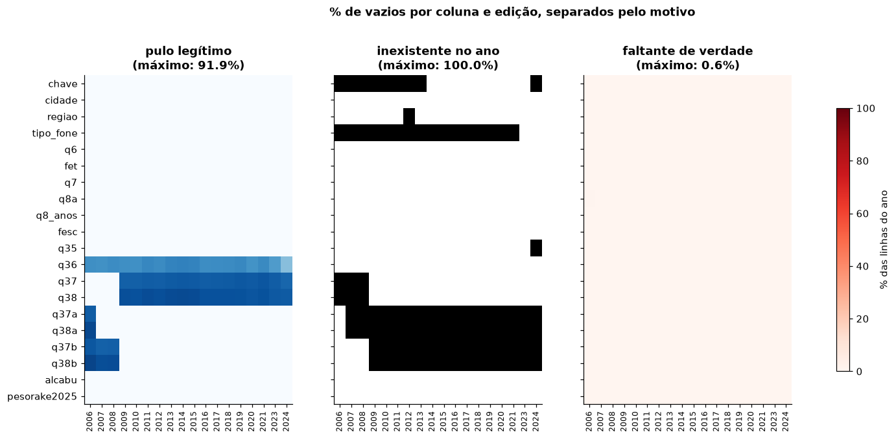
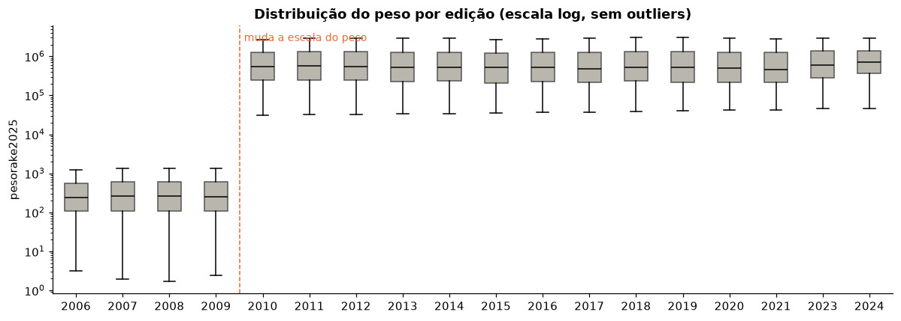
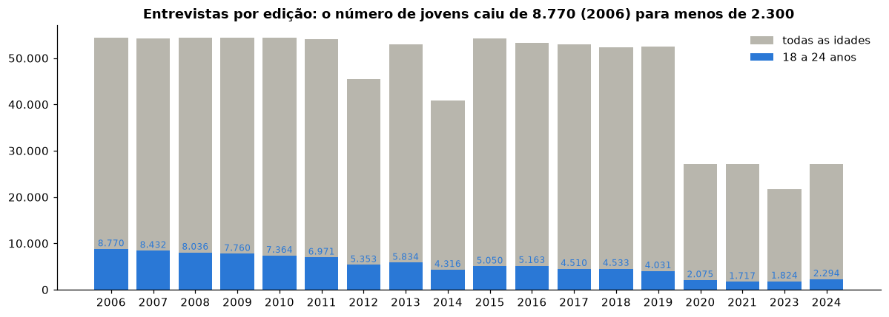
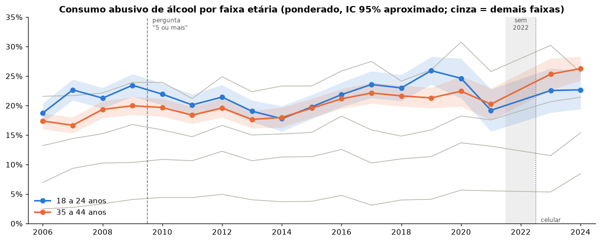
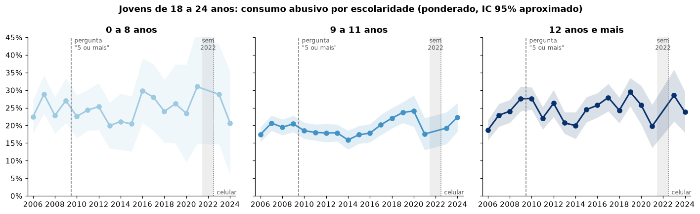
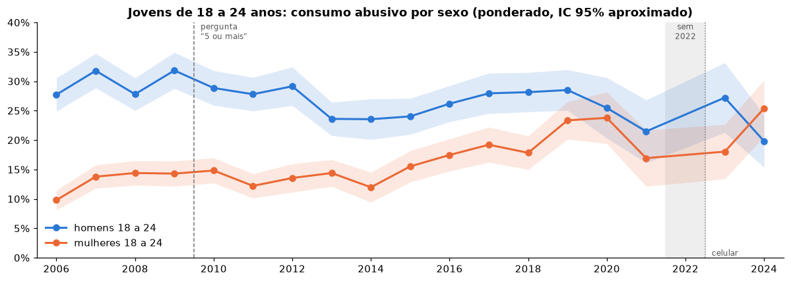
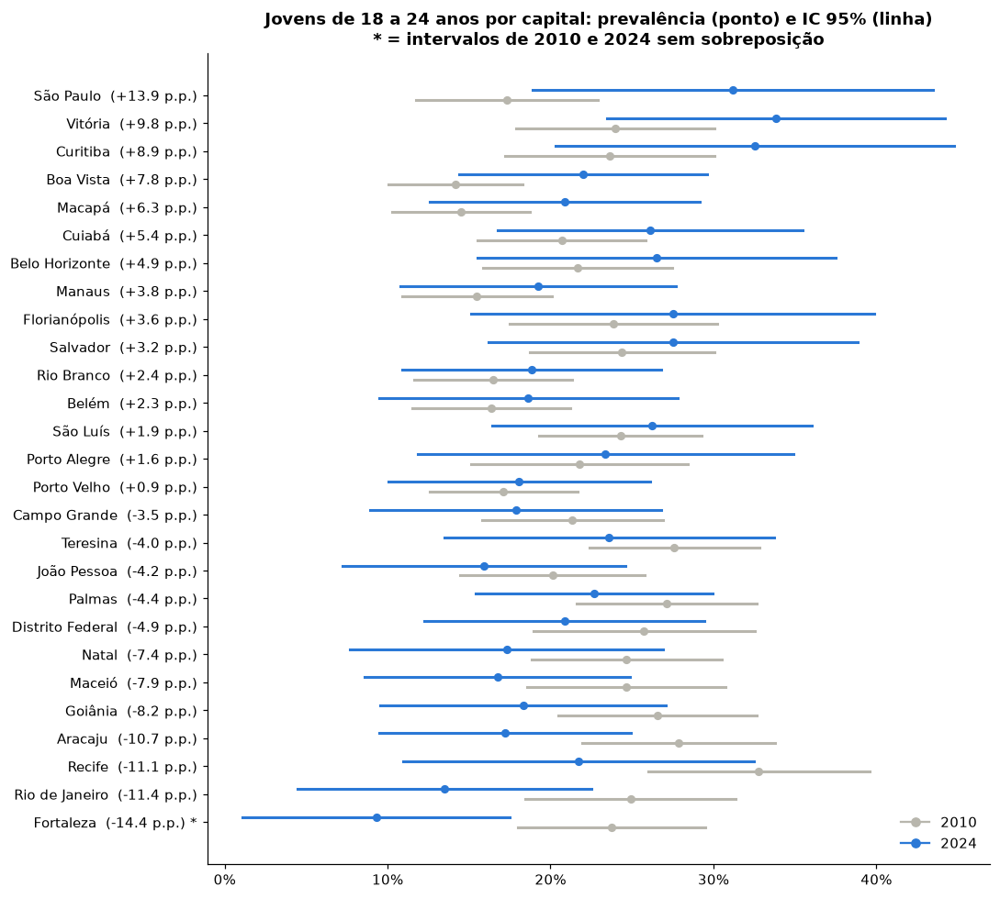

# Relatório de Análise Exploratória de Dados v3

**Relatório consolidado da exploração da base, antes das decisões de tratamento.** Documento companheiro do notebook `MVP_GenZ_Alcool_01_AED_v2.ipynb`.

**Projeto:** MVP Geração Z e consumo de álcool (PSP8, Prof. André Luiz Marques Serrano, EPR/FT/UnB)

**Autor:** Guilherme Augusto Fontes Cunha

**Versão:** v3, 16 out. 2026. Substitui a v2. Registra as decisões de tratamento D1 a D13, tomadas pelo autor, com os motivos de cada uma (seção 6), a mudança do objetivo para a comparação entre gerações e a prévia por geração (seção 5.5). O histórico está na seção 9.

**Etapa do ciclo:** 1 (busca) e 2 (coleta e análise exploratória) concluídas; **decisões de tratamento tomadas** (seção 6). As decisões estão aplicadas no notebook de AED v3 e no pipeline do Databricks, validados por execução local; falta a execução no Databricks.

**Arquivos de referência:** `README.md` (objetivo, versão 2), `DECISOES_TRATAMENTO.md` (tabela-resumo das decisões), `POSSIVEIS_DESCOBERTAS.md`, notebook `notebooks/aed/MVP_GenZ_Alcool_01_AED_v3.ipynb` (exploração, decisões e prévia com as decisões aplicadas), pipeline `notebooks/01` a `05` com `scripts/`, tabelas em `notebooks/aed/saidas_aed_v3/`, figuras em `figuras_relatorio_v2/`, documentação oficial em `docs_fonte/`.

**Como ler as notas:** toda variável citada recebe um número sobrescrito fixo, o mesmo do notebook (q37 é sempre ¹ e q38 é sempre ²). A redação oficial de cada pergunta e a definição de cada variável derivada estão no Apêndice A.

---

## 1. Resumo

| Tema | Achado | Consequência |
|---|---|---|
| Fonte | Vigitel 2006-2024 harmonizado: 833.217 entrevistas, 486 colunas, 18 edições (não existe 2022) | É a base ideal: oficial, num arquivo só, com peso e indicador prontos |
| Indicador | `alcabu`¹⁸ reproduzido em 100% dos registros a partir de `q37`¹/`q38`² (e `q37b`¹¹/`q38b`¹² em 2006-2008) | Pode ser usado como está |
| Vazios | Quase todos são pulo de questionário ou variável inexistente no ano; faltante de verdade só em 346 respostas de `q8a`⁷ (2006) | Os vazios não ameaçam a análise; as sete colunas da análise têm 0% de vazio |
| Pergunta de doses | Mudou de "mais do que 5/4 doses" para "5/4 ou mais" **em 2010**; a base guarda 2009 já na coluna nova | 2010 é o primeiro ano comparável, como o README previu; 2009 não pode ser juntado a 2010+ |
| Modo de coleta | 2010 só fixo; 2024 com mais de 90% celular. Em 2023, celular 27,0% contra fixo 15,5% no mesmo ano | A comparação 2010 x 2024 mistura comportamento e método |
| Filtro de 2024 | `q35`³ ("costuma beber?") foi substituída por `R501`¹³/`R502`¹⁴ ("bebeu nos últimos 12 meses?") | Mais gente entra no bloco de álcool em 2024; tende a elevar a prevalência |
| Pesos | Escala muda em 2010; de 2010 em diante a soma acompanha o número de entrevistas | Prevalência dentro do ano é correta; juntar anos exige normalizar |
| Amostra | Jovens: 7.364 (2010) para 2.294 (2024); cerca de 85 por capital em 2024 | P5 com 2024 isolado não tem precisão |
| Objetivo (v3) | Reformulado pelo autor: comparar gerações aos 18-24 anos (millennials, zillennials, geração Z) em vez de anos | Ver seção 6.1 e README |
| Prévia por geração (v3) | Homens: 30,3% → 25,5% → 22,2%; mulheres: 15,4% → 17,0% → 19,3%. Homens moderam (menos exagero entre quem bebe); mais mulheres bebem | Possíveis descobertas, a confirmar (seção 5.5) |
| Prévia por ano (v2) | Jovens: 21,9% (2010), 25,9% (2019), 22,7% (2024). Jovens mulheres sobem de 14,8% para 25,4%; jovens homens caem de 28,9% para 19,8% só em 2024 | A premissa do README (queda entre jovens) não aparece; o movimento forte é por sexo |

---

## 2. O que foi feito até agora

| Data | Passo |
|---|---|
| 16/10/2026 | Busca da fonte; download do ZIP oficial, do dicionário, das orientações, da nota metodológica e dos relatórios |
| 16/10/2026 | Notebook AED v1: leitura fiel, conferência, vazios, dicionário, chave, cobertura, modo de coleta, idade, escolaridade, medida, pesos, prévia e decisões em aberto (D1 a D12) |
| 16/10/2026 | Revisão do autor; comentários acumulados em `PENDENCIAS_AED.md` (itens 1 a 5) |
| 16/10/2026 | Leitura dos questionários dos relatórios 2008, 2009, 2010, 2023 e 2006-2024 para as notas das variáveis; achados novos (seções 4.2 e 4.3) |
| 16/10/2026 | Notebook AED v2 e relatório v2 |
| 16/10/2026 | Decisões de tratamento D1 a D13, uma a uma, com opções, prós e contras; objetivo reformulado para gerações; prévia por geração e decomposição do consumo abusivo; este relatório (v3) |

---

## 3. A fonte e o arquivo

| Item | Valor |
|---|---|
| Fonte | Ministério da Saúde, SVSA/DAENT, *Vigitel Brasil 2006-2024*, base harmonizada |
| Página | <https://svs.aids.gov.br/daent/cgdnt/vigitel/> |
| Arquivo | `vigitel-2006-2024-peso-rake-csv.zip` (87.121.523 bytes), com um CSV de 577 MB |
| SHA-256 do ZIP | `40139996d11deb2f52730c90f14e2df4bf5e53aba3cf1848fce391c93ff77993` |
| Publicação | 24/08/2026 (versão sem rótulos, para evitar divergência com o dicionário) |
| Coleta | 16/10/2026 |
| Licença do portal | Creative Commons Atribuição-SemDerivações 3.0 |
| Peso indicado pela orientação oficial | `pesorake2025`¹⁹ (Censo 2022 para 2010-2024) |

**Por que esta base.** É a fonte oficial do indicador de consumo abusivo citado no README; junta todas as edições num arquivo com um dicionário único; traz o peso recalibrado pelo Censo 2022 e o indicador `alcabu`¹⁸ pronto.

**Como o arquivo foi lido.** O CSV mistura codificações (1.555 linhas não são UTF-8, todas em campos de texto livre) e tem 408 linhas com campos entre aspas e vírgulas dentro. A leitura usa `latin-1`, respeita as aspas e mantém todas as linhas, com um recorte de 21 colunas (as das perguntas e as de controle). Os campos de texto livre ficam fora: não respondem às perguntas e podem conter informação pessoal.

---

## 4. Achados da exploração

### 4.1 Vazios: três categorias (item 1 das pendências)

A v1 pintava de preto qualquer vazio. A v2 separa:

| Categoria | Significado | Onde aparece | Volume |
|---|---|---|---|
| Pulo legítimo | A pergunta não se aplicava | `q36`⁴ (quem não bebe), `q37`¹/`q38`² (outro sexo ou bebe menos de uma vez por mês), versões antigas | 534 mil em `q36`⁴; 556 mil em `q37`¹; 588 mil em `q38`² |
| Inexistente no ano | A variável não existia ou não foi publicada | `chave` (2006-2013 e 2024), `tipo_fone` (até 2021), `regiao` (2012), `q35`³ (2024), versões antigas fora do seu período | coluna inteira vazia no ano |
| Faltante de verdade | Devia haver resposta e não há | `q8a`⁷ em 2006 | 346 respostas (0,04% da base) |

As sete colunas que respondem às perguntas (`ano`, `cidade`, `fet`¹⁵, `q7`⁶, `fesc`¹⁷, `alcabu`¹⁸, `pesorake2025`¹⁹) têm 0% de vazio em todos os anos.

**O que o mapa não mostra:**
1. **Imputação:** `fesc`¹⁷ não tem vazios porque o Ministério imputa a escolaridade de quem respondeu 777 ou 888 em `q8a`⁷ (8.170 casos, 1%).
2. **Vazio tratado como "não":** o `alcabu`¹⁸ vale 0 quando `q37`¹/`q38`² estão vazias. A conferência mostra que, em todas as edições (inclusive 2024), 100% de quem bebe pelo menos uma vez por mês respondeu e ninguém fora do filtro respondeu. O vazio é pulo, e o 0 está correto. Em 2024 não dá para saber por que alguém ficou fora do bloco (nunca bebeu, não bebeu em 12 meses ou recusou), porque `R501`¹³ e `R502`¹⁴ não foram publicadas.
3. **Não resposta à pesquisa:** quem não atendeu o telefone não aparece. O peso corrige sexo, idade e escolaridade, mas não diferenças de comportamento; pode ser MNAR e só pode ser declarado.

### 4.2 A medida de consumo e o questionário (achado novo da v2)

**A pergunta de doses mudou em 2010.** Os questionários dos relatórios mostram:

| Edições | Coluna na base | Redação | Limite real |
|---|---|---|---|
| 2006-2008 | `q37b`¹¹, `q38b`¹² | "mais do que 5 doses" (homem) / "mais do que 4" (mulher) | 6+ / 5+ |
| 2009 | `q37`¹, `q38`² | "mais do que 5 doses" / "mais do que 4" | 6+ / 5+ |
| 2010-2024 | `q37`¹, `q38`² | "cinco ou mais doses" / "quatro ou mais" | 5+ / 4+ |

As *Orientações* (item 3.3) dizem que a redação mudou "a partir de 2010", e o questionário de 2009 confirma. A base, porém, guarda 2009 já na coluna nova, o que na v1 pareceu uma contradição com o documento. Consequências: 2010 é o primeiro ano da pergunta atual, o que sustenta a escolha do README; 2009 não é comparável com 2010 em diante; o salto de 2009 para 2010 na série pode ter parte artificial.

**A pergunta de entrada mudou duas vezes.** `q35`³ ("costuma consumir bebida alcoólica?") teve codificações diferentes em 2006, 2007-2019 e 2020-2023, e não existe em 2024: foi substituída por `R501`¹³ ("já consumiu na vida?") e `R502`¹⁴ ("consumiu nos últimos 12 meses?"). O dicionário rotula o código 2 de 2020+ como "sim, mas não no último mês", mas o questionário de 2023 traz 2 = "não" e 3 = "nunca".

**O filtro de 2024 é mais largo.** Entre todos os adultos, a parte fora do bloco de álcool caiu de 58,4% (2023) para 42,7% (2024), e "bebe menos de 1 dia por mês" subiu de 8,6% para 19,8%. Quem bebe menos de uma vez por mês continua pulando as doses, mas "menos de 1 dia por semana" subiu de 7,4% para 10,1%, e esse grupo responde às doses.

### 4.3 Modo de coleta: fixo e celular (item 5 das pendências)

Até 2021 só telefone fixo; em 2023, metade por celular; em 2024, mais de 90%. A troca é uma limitação porque:
1. **Quem é alcançado muda:** o jovem com fixo em 2010 era, em geral, quem morava com os pais; em 2024 o celular alcança quase todos.
2. **Como a pessoa responde muda:** no fixo de casa, com a família por perto, há mais viés de desejabilidade social.
3. **O peso não corrige:** ajusta sexo, idade, escolaridade e capital, mas não o comportamento associado a ter fixo.

**Evidência de 2023 (prevalência ponderada, IC 95% aproximado):**

| | Celular | Fixo |
|---|---|---|
| Todas as idades, 2023 | 27,0% (25,4 a 28,7), n = 10.832 | 15,5% (14,2 a 16,9), n = 10.858 |
| Jovens 18-24, 2023 | 25,7% (20,9 a 30,5), n = 1.232 | 19,5% (14,0 a 25,1), n = 592 |
| Todas as idades, 2024 | 23,2% (22,3 a 24,2), n = 24.448 | 11,7% (9,6 a 13,8), n = 2.600 |
| Jovens 18-24, 2024 | 24,8% (21,3 a 28,2), n = 2.187 | 10,5% (2,4 a 18,7), n = 107 |

O fixo tem muito mais idosos (38% das entrevistas de 2023 contra 9% no celular), mas a diferença aparece também entre os jovens. O peso é calibrado para a amostra total do ano, não por modo, então a tabela é indicativa.

### 4.4 Pesos (item 3 das pendências)

O peso diz quantas pessoas cada entrevistado representa. Leitura do gráfico: escala log (cada marca é 10 vezes a anterior), caixa com os 50% centrais, linha na mediana, bigodes sem os extremos.

1. **O salto de 2009 para 2010 é mudança de escala, não de população.** 2006-2009: mediana de cerca de 250, soma de cerca de 30 milhões (próxima da população adulta das capitais). 2010-2024: mediana de cerca de 500 mil, soma de dezenas de bilhões. As *Orientações* dizem que `pesorake2025`¹⁹ junta pesos antigos e recalibrados, mas não explicam a escala. De 2010 em diante a soma acompanha o número de entrevistas (peso médio estável, de 1,2 a 1,4 milhão).
2. **Para prevalência não importa**, desde que calculada dentro de cada ano: multiplicar todos os pesos por uma constante não muda a razão. **Importa** ao juntar anos (normalizar antes) e ao estimar totais de pessoas.
3. **A variação dentro do ano é proposital:** amostra parecida por capital (um entrevistado de São Paulo representa muito mais gente que um de Palmas) e correção de grupos que atendem pouco. O custo é precisão, medido pelo *n* efetivo de Kish.
4. **Correção:** na conversa de 16/10/2026 foi dito que os pesos de 2023-2024 subiram "porque a amostra encolheu". Isso estava errado: em 2020-2021 a amostra também caiu à metade e o peso médio não subiu. Em 2023-2024 subiu só a mediana (532 mil em 2019; 602 mil em 2023; 698 mil em 2024), com a média estável. Os pesos do fixo são bem maiores que os do celular (mediana de 733 mil contra 506 mil em 2023; 1,9 milhão contra 648 mil em 2024), o que explica parte da mudança, mas não toda: o próprio celular de 2024 tem mediana acima da de 2019. Hipótese em aberto.

### 4.5 Idade e escolaridade

- `fet`¹⁵ é coerente com `q6`⁵ em todos os registros. Há 46 idades acima de 100 anos, fora das faixas da análise.
- `fesc`¹⁷ bate com a faixa recalculada a partir de `q8_anos`¹⁶ em 100% dos registros, mas é imputada nos 777/888 de `q8a`⁷. Em 2006 `q8a`⁷ usa outra codificação.
- **Composição dos jovens mudou** (com peso): 0 a 8 anos caiu de 14,4% (2010) para 8,3% (2024); 9 a 11 anos subiu de 54,4% para 58,7%. Sem peso, a amostra superestima a alta escolaridade (39,5% contra 31,2% em 2010). A P2 precisa ser respondida dentro de cada faixa.

### 4.6 Amostra e precisão

Jovens entrevistados: 7.364 em 2010, 4.031 em 2019, 2.294 em 2024. Na faixa de 0 a 8 anos de estudo, pouco mais de 100 jovens nas edições recentes. Por capital, a mediana caiu de 270 jovens (2010) para 84 (2024); 20 das 27 capitais têm menos de 100 jovens em 2024.

### 4.7 Chave e outros

- `chave` só existe de 2014 a 2023 e, mesmo nesses anos, se repete (147 mil registros com chave repetida). Não serve como identificador.
- 58 mil linhas são idênticas nas 21 colunas do recorte; sem chave confiável, não há como distinguir pessoas com respostas iguais, e elas não são removidas.

---

## 5. Primeiro olhar sobre as perguntas (exploratório, não é o teste)

As subseções 5.1 a 5.4 seguem a formulação original do README (comparação entre anos) e repetem a v2. A subseção 5.5, nova, segue a formulação por geração adotada na D2.

Prevalências ponderadas por `pesorake2025`¹⁹, com IC 95% aproximado pelo *n* efetivo de Kish. O IC 95% é a faixa onde o valor verdadeiro provavelmente está; quanto menos entrevistas, mais larga.

### 5.1 P1 e P3 (formulação original): jovens contra 35 a 44 anos

| Faixa | 2010 | 2019 | 2024 | 2010 → 2019 | 2010 → 2024 |
|---|---|---|---|---|---|
| 18 a 24 | 21,9% | 25,9% | 22,7% | +4,0 p.p. | +0,8 p.p. |
| 35 a 44 | 19,7% | 21,3% | 26,3% | +1,6 p.p. | +6,6 p.p. |

A comparação mais limpa é 2010 x 2019 (mesma pergunta, só telefone fixo). Nela os jovens **sobem** 4,0 p.p. e a faixa de 35 a 44 anos, 1,6 p.p. A alta das faixas mais velhas parece vir sobretudo de 2023-2024, quando o método mudou. Em nenhuma das duas comparações aparece a queda que o README supõe.

### 5.2 P2 (formulação original): jovens por escolaridade

As três faixas oscilam muito de um ano para outro, sem tendência comum clara (2010 → 2024: 0 a 8 anos, 22,5% → 20,7%; 9 a 11, 18,5% → 22,3%; 12 e mais, 27,7% → 23,8%). A faixa de 0 a 8 anos tem pouco mais de 100 jovens nas edições recentes.

### 5.3 P4 (formulação original): jovens por sexo

| Sexo e faixa | 2010 | 2019 | 2024 |
|---|---|---|---|
| Mulheres 18-24 | 14,8% | 23,4% | 25,4% |
| Mulheres 25-34 | 14,1% | 20,3% | 20,5% |
| Mulheres 35-44 | 10,9% | 14,6% | 20,5% |
| Homens 18-24 | 28,9% | 28,5% | 19,8% |
| Homens 25-34 | 34,7% | 32,5% | 31,1% |
| Homens 35-44 | 30,5% | 29,3% | 32,7% |

- **Mulheres:** a alta das jovens já era visível em 2019, ainda só com fixo, então resiste à troca de método. As mulheres de 25 a 44 anos subiram quase tanto, o que sugere uma mudança das mulheres em geral, e não da geração Z.
- **Homens:** os jovens são o único grupo masculino que caiu, o que lembra um efeito de geração. A queda, porém, aparece só em 2024, o ano da amostra menor, do celular e do novo filtro.
- **Cuidado de leitura:** o indicador mede consumo episódico pesado nos últimos 30 dias, e não dependência ou "problemas com álcool".

### 5.4 P5 (formulação original): capitais

15 capitais subiram e 12 caíram de 2010 para 2024. As maiores altas (São Paulo, Vitória, Curitiba) e quedas (Fortaleza, Rio de Janeiro, Recife) têm intervalos largos: a largura mediana do IC passou de 11 p.p. (2010) para 18 p.p. (2024). Só em Fortaleza os intervalos não se sobrepõem. Florianópolis, com 53 jovens em 2024, tem intervalo de 15% a 40%. Um ranking com 2024 isolado seria enganoso.

---

### 5.5 Prévia por geração (base das decisões D2 e D6)

As tabelas desta subseção foram calculadas durante a discussão das decisões, com o peso de cada edição normalizado para somar 1 (D4) e só com as edições de 2010 em diante (D5). Geração = ano da edição menos a idade. São números de exploração, ainda sem os testes e as sensibilidades previstos.

**Consumo abusivo aos 18-24 anos, por geração** (prevalência ponderada, % e margem de erro aproximada de 95%):

| Geração (nascidos em) | Observados aos 18-24 em | Total | Homens | Mulheres |
|---|---|---|---|---|
| Millennials (1986-1992) | 2010-2016, só fixo | 22,8 ±1,0 | 30,3 ±1,6 | 15,4 ±1,2 |
| Zillennials (1993-1998) | 2011-2021, só fixo | 21,3 ±0,9 | 25,5 ±1,4 | 17,0 ±1,2 |
| Geração Z (1999-2006) | 2017-2024, 33% celular | 20,8 ±1,5 | 22,2 ±2,3 | 19,3 ±2,1 |

Só aos 18-21 anos, em que todas as gerações aparecem na mesma idade: homens 27,6 → 22,8 → 21,0; mulheres 12,3 → 13,5 → 18,9.

**Decomposição: quem bebe e quanto exagera** (18-24 anos, edições de 2010 a 2023, porque `q35`³ não existe em 2024):

| Geração | Sexo | Costuma beber (`q35`³) | Bebe ao menos 1x/mês (`q36`⁴) | Consumo abusivo (`alcabu`¹⁸) | Abusivo entre quem bebe ao menos 1x/mês |
|---|---|---|---|---|---|
| Millennials | Homens | 51,4 | 46,1 | 30,3 | 65,7 |
| Zillennials | Homens | 45,8 | 40,0 | 25,5 | 63,7 |
| Geração Z | Homens | 48,6 | 38,5 | 22,8 | 59,2 |
| Millennials | Mulheres | 32,3 | 26,8 | 15,4 | 57,5 |
| Zillennials | Mulheres | 34,8 | 28,6 | 17,0 | 59,7 |
| Geração Z | Mulheres | 39,8 | 30,9 | 17,6 | 57,0 |

**Leitura (preliminar):** nos homens, a proporção dos que bebem quase não muda e o que cai é o exagero entre quem bebe; nas mulheres, o exagero fica estável e sobe a proporção das que bebem. A distância entre os sexos no consumo abusivo caiu de 15 para 3 pontos. Nos adultos de todas as idades, "costuma beber" ficou estável entre os homens (52% em 2010, 53% em 2023) e subiu entre as mulheres (27% → 37%). Esses achados estão registrados como possíveis descobertas em `POSSIVEIS_DESCOBERTAS.md` e serão confirmados na camada analítica.

---

## 6. Decisões de tratamento e os motivos do autor

As 13 decisões foram tomadas pelo autor em 16/10/2026, uma a uma, a partir de opções com prós e contras apresentadas para cada problema. Para cada decisão, este relatório registra o problema, a decisão, as alternativas descartadas, **o motivo do autor** (com as palavras dele quando ele as deu) e a evidência que pesou. Quando o autor adotou a opção sugerida sem acrescentar um motivo próprio, isso está dito. A tabela-resumo também está em `DECISOES_TRATAMENTO.md`.

### 6.1 Mudança do objetivo (consequência da D2)

A discussão da D2 levou o autor a trocar a comparação entre anos (2010 contra o ano mais recente) pela **comparação entre gerações na mesma idade**. O motivo do autor: o interesse é **"ver recortes da geração Z, e a transição zillennial"**, e o README podia mudar **"contanto que continue sendo uma pergunta de negócio e siga conforme o MVP"**. O README foi reescrito (versão 2 do objetivo): a hipótese passou a ser que, aos 18-24 anos, o consumo abusivo diminui de uma geração para a seguinte (millennials → zillennials → geração Z), nos dois sexos e em todas as faixas de escolaridade. A decisão de negócio ganhou uma segunda pergunta: tratar a demanda jovem por produtos sem álcool como estrutural ou como fase de idade. A formulação original está no Anexo A do README.

### 6.2 Decisões, uma a uma

**D1. Não existe a edição de 2022**
- **Decisão:** manter a lacuna à vista: a série pula de 2021 para 2023, sem nenhum valor criado; nos gráficos, 2022 é uma faixa cinza "sem 2022". Em cálculos de tendência, o ano entra como número.
- **Alternativas descartadas:** ligar 2021 a 2023 com linha tracejada só no gráfico; imputar 2022 (por exemplo, pela média de 2021 e 2023).
- **Motivo do autor:** "para não criar nenhum dado".
- **Evidência:** as *Orientações* oficiais confirmam que não há dados de 2022; uma linha ligando 2021 e 2023 uniria dois anos com mudança de método (pandemia e início do celular).

**D2. Qual comparação usar, dado que o método mudou entre 2010 e 2024**
- **Decisão:** comparar **gerações**, e não anos: millennials (nascidos em 1986-1992), zillennials (1993-1998) e geração Z (1999-2006), sempre aos 18-24 anos, com as edições de 2010 em diante.
- **Alternativas descartadas:** 2024 como resultado principal e 2019 como sensibilidade (era a sugestão inicial); só 2024; só 2019; 2023 e 2024 juntos; só o fixo de 2023; três quinquênios (2010-2014, 2015-2019 e 2020-2024), proposto pelo próprio autor e depois superado pela abordagem por geração.
- **Motivo do autor:** ver os recortes da geração Z e a transição zillennial, mantendo uma pergunta de negócio (seção 6.1). Foi o autor quem propôs comparar períodos de 5 anos em vez de anos isolados; a abordagem por geração veio da pergunta dele sobre a transição zillennial.
- **Evidência:** a comparação entre anos misturava comportamento e método (seções 4.2 e 4.3); a comparação millennials x zillennials é toda por telefone fixo e com a mesma pergunta; juntar edições dá precisão (margem de ±1 ponto por geração, contra ±3 de um ano isolado).

**D3. Amostra pequena num ano isolado**
- **Decisão:** resolvida pela D2: cada geração junta todas as edições em que foi observada aos 18-24 anos (cerca de 24 mil millennials, 27 mil zillennials e 10 mil da geração Z).
- **Alternativas descartadas:** anos isolados; triênios; quinquênios.
- **Motivo do autor:** decidida junto com a D2, como consequência dela.

**D4. Pesos com escalas diferentes entre anos**
- **Decisão:** normalizar o peso de cada edição para somar 1 antes de juntar edições, para que cada ano conte igual dentro da geração.
- **Alternativas descartadas:** usar o peso original (os anos de 2010 em diante dominariam a soma); normalizar proporcionalmente ao tamanho da amostra de cada ano.
- **Motivo do autor:** decidida junto com a D2, porque juntar anos exige pesos na mesma escala.
- **Evidência:** a soma dos pesos é de cerca de 30 milhões em 2006-2009 e de dezenas de bilhões de 2010 em diante (seção 4.4).

**D5. A pergunta de doses mudou em 2010**
- **Decisão:** análise só com as edições de 2010 em diante; 2006-2009 ficam guardados na camada bronze, sem nada apagado. O filtro é feito pelo ano, e não pelo nome da coluna, porque a base guarda 2009 (pergunta antiga) já na coluna nova.
- **Alternativas descartadas:** mostrar 2006-2009 só como contexto nos gráficos; converter 2006-2009 para a pergunta nova (inviável: a base não registra o número de doses).
- **Motivo do autor:** "para não ter que explicar mais uma mudança de pergunta que pode ter influenciado a resposta".
- **Evidência:** questionários de 2008, 2009 e 2010 (seção 4.2).

**D6. A pergunta "costuma beber?" (`q35`³) mudou e não existe em 2024**
- **Decisão:** decompor o consumo abusivo em duas partes: (1) **quem bebe pelo menos uma vez por mês**, medido pela `q36`⁴ (de 2010 a 2024); (2) **consumo abusivo entre quem bebe**. A `q35`³ fica só como conferência de 2010 a 2023. É uma definição própria, declarada como tal.
- **Alternativas descartadas:** usar só o `alcabu`¹⁸ (era a sugestão inicial); indicador complementar sem decomposição; usar a `q35`³ diretamente (perderia 2024).
- **Motivo do autor:** o autor achou que valia **"comparar o q35 ao longo dos anos, sexos, escolaridades"**, perguntando **"será que não diz algo?"**. A exploração mostrou que dizia (seção 5.5), e o autor pediu para registrar o achado como possível descoberta. Escolheu medir "quem bebe" pela `q36`⁴ para **não perder 2024**, o ano com mais jovens da geração Z.
- **Evidência:** a decomposição mostra caminhos diferentes por sexo: homens jovens moderam, mulheres jovens entram no consumo (seção 5.5).

**D7. A composição dos jovens por escolaridade mudou**
- **Decisão:** responder a P2 dentro de cada faixa de escolaridade e, na P1, mostrar a média padronizada pela composição de escolaridade dos millennials ao lado da média real.
- **Alternativas descartadas:** só a análise dentro das faixas (era a sugestão inicial); só a média padronizada.
- **Motivo do autor:** "me parece mais completa". Se a média real e a padronizada forem parecidas, o efeito composição fica descartado com evidência.
- **Evidência:** a parte dos jovens com 0 a 8 anos de estudo caiu de 14,4% (2010) para 8,3% (2024) (seção 4.5).

**D8. A escolaridade é estimada pelo Ministério quando a pessoa não informa**
- **Decisão:** aceitar a `fesc`¹⁷ oficial em todos os registros e refazer a P2 sem os casos estimados, como sensibilidade.
- **Alternativas descartadas:** aceitar sem sensibilidade; excluir os casos estimados.
- **Motivo do autor:** adotou a opção sugerida, pelos argumentos dela: mantém todos os entrevistados, é coerente com o peso (que usa a mesma escolaridade estimada) e prova com número que a estimativa não muda a conclusão.
- **Evidência:** 8.170 casos com `q8a`⁷ = 777 ou 888, cerca de 1% da base (seção 4.5).

**D9. Poucos jovens por capital**
- **Decisão:** capitais em primeiro plano: as 27 aparecem cada uma com a prevalência por geração e a margem de erro, e as que têm diferença fora da margem são destacadas. Quando a capital for inconclusiva, mostra-se ao lado o dado da sua região, mais preciso, com texto explícito.
- **Alternativas descartadas:** regiões como resultado principal e capitais como detalhe (era a sugestão inicial); só capitais; só regiões.
- **Motivo do autor:** **"a decisão deve ser valiosa a empresários de vários lugares do Brasil"**. A opção com capitais em primeiro plano surgiu desse critério: todo empresário encontra a sua cidade, e nenhum fica sem resposta útil.
- **Evidência:** cerca de 390 jovens da geração Z por capital, com margem de cerca de ±6 pontos para a diferença entre gerações (seção 4.6).

**D10. A base não tem identificador confiável do entrevistado**
- **Decisão:** chave substituta = edição + número da linha no arquivo original (por exemplo, `2024-000815`), criada na camada bronze antes de qualquer filtro; a `chave` oficial fica só como coluna de referência.
- **Alternativas descartadas:** número sequencial simples; código calculado do conteúdo da linha (quebra com linhas idênticas); chave oficial onde existir e substituta no resto.
- **Motivo do autor:** adotou a opção sugerida, pelos argumentos dela: única, sempre preenchida e rastreável até a linha exata do arquivo oficial. A dependência da ordem do arquivo é coberta pela conferência do SHA-256.
- **Evidência:** `chave` só existe em 2014-2023 e se repete em 147 mil registros (seção 4.7).

**D11. Edições de 2020 e 2021 coletadas na pandemia**
- **Decisão:** manter 2020 e 2021, com nota, e refazer a análise sem eles como sensibilidade.
- **Alternativas descartadas:** manter só com nota; excluir os dois anos.
- **Motivo do autor:** adotou a opção sugerida, pelos argumentos dela: a pandemia faz parte da juventude real dessas gerações, e a sensibilidade testa se a conclusão depende dela. Excluir os dois anos tiraria mais de um terço da geração Z.
- **Evidência:** amostra reduzida à metade e consumo abusivo dos jovens de 19,2% em 2021, o menor desde 2014 (seção 5).

**D12. Texto livre com codificação mista e `regiao` vazia em 2012**
- **Decisão:** texto livre só na camada bronze, fora das camadas tratada e analítica; região derivada da capital (`cidade`) em todos os anos, por uma tabela fixa 27 capitais → 5 regiões registrada no catálogo.
- **Alternativas descartadas:** corrigir a codificação e manter o texto livre; completar só 2012 pela capital.
- **Motivo do autor:** **"para remover risco de dado pessoal e outros motivos"**: minimização exigida pela LGPD, sem perder nada que a análise use, e região exata e completa em todos os anos.

**D13. Em 2024 o filtro de entrada do bloco de álcool mudou**
- **Decisão:** manter 2024, declarar a limitação e refazer todos os indicadores sem 2024 como sensibilidade (consumo abusivo, quem bebe e abuso entre quem bebe). Sem 2024, a geração Z fica com 2017-2023. Esta sensibilidade absorve a prevista na D6.
- **Alternativas descartadas:** manter só com a limitação declarada; excluir 2024 (perderia cerca de 22% da geração Z e o dado mais recente).
- **Motivo do autor:** a opção **"fecha as duas mudanças de 2024 com um único teste"** (o filtro novo e o celular).
- **Evidência:** a parte da população fora do bloco de álcool caiu de 58,4% (2023) para 42,7% (2024) (seção 4.2).

### 6.3 Sensibilidades previstas

As decisões criaram um conjunto de testes de robustez, que a camada analítica vai executar:

| Sensibilidade | Origem | O que testa |
|---|---|---|
| Comparação só aos 18-21 anos | D2 | A geração Z só aparece nas idades mais baixas |
| Geração Z só com entrevistas por fixo (2017-2021) | D2 | Efeito do celular |
| Média padronizada pela escolaridade dos millennials | D7 | Efeito composição |
| P2 sem os casos de escolaridade estimada | D8 | Estimativa do Ministério |
| Sem 2020 e 2021 | D11 | Pandemia |
| Sem 2024 | D6, D13 | Filtro novo e celular juntos |

---

## 7. Fontes consultadas

### 7.1 Dados
- BRASIL. Ministério da Saúde. *Vigitel Brasil 2006-2024: base de dados harmonizada, formato CSV* (`vigitel-2006-2024-peso-rake-csv.zip`). Publicada em 24/08/2026. Disponível em <https://svs.aids.gov.br/daent/cgdnt/vigitel/>. Acesso em 16/10/2026.

### 7.2 Documentação da base (em `docs_fonte/`)
- *Dicionário de dados do Vigitel Brasil 2006-2024* (`dicionario-vigitel-2006-2024.xlsx`), abas *Variáveis_Vigitel* e *Indicadores_Vigitel*.
- *Orientações para análise do Vigitel Brasil 2006-2024* (21/08/2026): edição x ano de coleta, `q8_anos`¹⁶, mudança de redação de `q37`¹/`q38`², peso `pesorake2025`¹⁹.
- *Nota metodológica do Vigitel Brasil 2006-2024* (21/08/2026): revisão dos totais populacionais de Florianópolis e Fortaleza.

### 7.3 Relatórios e questionários (em `docs_fonte/`)
- *Vigitel Brasil 2006-2024* (questionário de 2024, p. 186-199): `R501`¹³, `R502`¹⁴, `q36`⁴, `q37`¹, `q38`².
- *Vigitel Brasil 2010* (questionário, p. 141): `q35`³ a `q38`², redação "5 ou mais".
- *Vigitel Brasil 2009* (questionário, p. 139): redação "mais do que 5" ainda em 2009.
- *Vigitel Brasil 2008* (questionário, p. 109): `q37b`¹¹/`q38b`¹².
- *Vigitel Brasil 2023* (questionário, p. 119): codificação de `q35`³ em 2023.
- *Vigitel Brasil 2006*: definição do indicador em 2006 (o questionário não foi publicado no relatório).
- *Vigitel Brasil 2006-2023: tabagismo e consumo abusivo de álcool*.

---

## 8. Próximos passos

1. ~~Notebook de AED v3 com as decisões aplicadas~~: feito (`MVP_GenZ_Alcool_01_AED_v3.ipynb`, seções 14 e 15).
2. ~~Pipeline no Databricks~~: escrito (`notebooks/01` a `05`, `scripts/`) e validado no simulador local (`tests/rodar_local.py`; log em `evidencias/`): bronze com as 833.217 linhas, silver com 615.877, modelo estrela íntegro, 16 regras de qualidade sem violação. Resultado preliminar no README, seção 9: hipótese **parcialmente refutada** (queda geracional só entre os homens).
3. ~~Mais visualizações para a apresentação~~: feito (17/10/2026), a pedido do professor. O módulo `scripts/graficos.py` gera 14 figuras numeradas na ordem da apresentação (README, seção 9.1). O notebook novo `06_correlatos` testa 21 características do Vigitel contra o consumo abusivo entre jovens (README, seção 9.2; `POSSIVEIS_DESCOBERTAS.md`, item 3).
4. **Executar no Databricks e no Colab**, com os screenshots de evidência (até aqui, tudo foi executado só localmente).
5. Confirmar ou descartar as possíveis descobertas de `POSSIVEIS_DESCOBERTAS.md` com os resultados do Databricks e escrever a discussão e a autoavaliação.

---

## 9. Histórico de versões

| Versão | Data | O que mudou |
|---|---|---|
| v1 | 16/10/2026 | Notebook de exploração inicial (sem relatório) |
| v2 | 16/10/2026 | Vazios em três categorias; notas com a redação oficial de toda pergunta e a definição de toda variável derivada; leitura didática dos pesos, com correção sobre 2023-2024; capitais com prevalência e IC; efeito do modo de coleta; achados novos (pergunta de doses mudou em 2010; filtro de 2024); D3 e D5 revistas, D13 nova; comparação 2010 x 2019 como sensibilidade |
| v3 | 16/10/2026 | Decisões de tratamento D1 a D13 tomadas pelo autor, com os motivos registrados (seção 6); objetivo reformulado para comparar gerações (README, versão 2 do objetivo); prévia por geração e decomposição do consumo abusivo (seção 5.5); sensibilidades previstas (seção 6.3). As seções 3 a 5.4 repetem a v2 sem mudança |

---

## Apêndice A. Notas das variáveis

Fonte das redações: questionários nos apêndices dos relatórios Vigitel 2008, 2009, 2010, 2023 e 2006-2024; dicionário oficial para as versões de 2006 e para as variáveis derivadas.

¹ **q37**: pergunta, só homens: "Nos últimos 30 dias, o Sr. chegou a consumir cinco ou mais doses de bebida alcoólica em uma única ocasião? (cinco doses de bebida alcoólica seriam cinco latas de cerveja, cinco taças de vinho ou cinco doses de cachaça, whisky ou qualquer outra bebida alcoólica destilada)". 1 = sim, 2 = não. Feita só a quem bebe pelo menos uma vez por mês (q36 de 1 a 5). Redação "cinco ou mais" desde 2010; em 2009 a mesma coluna guarda a redação antiga, "mais do que 5 doses" (questionários Vigitel 2009, 2010 e 2006-2024).

² **q38**: pergunta, só mulheres: "Nos últimos 30 dias, a Sra. chegou a consumir quatro ou mais doses de bebida alcoólica em uma única ocasião? (quatro doses de bebida alcoólica seriam quatro latas de cerveja, quatro taças de vinho ou quatro doses de cachaça, whisky ou qualquer outra bebida alcoólica destilada)". 1 = sim, 2 = não. Mesmo filtro e mesma mudança de redação de q37 ("mais do que 4 doses" em 2009).

³ **q35**: pergunta, a todos: "O(a) Sr.(a) costuma consumir bebida alcoólica?". 2007-2019: 1 = sim, 2 = não. 2023: 1 = sim, 2 = não, 3 = nunca, 888 = não quis informar. 2006 e 2020-2021 têm outras codificações. Não existe em 2024: foi substituída por R501 e R502.

⁴ **q36**: pergunta, só a quem bebe: "Com que frequência o(a) Sr.(a) costuma consumir alguma bebida alcoólica?". 1 = 1 a 2 dias por semana, 2 = 3 a 4, 3 = 5 a 6, 4 = todos os dias, 5 = menos de 1 dia por semana, 6 = menos de 1 dia por mês (pula as perguntas de doses). 2006 usa outra codificação.

⁵ **q6**: pergunta, a todos: "Qual sua idade?" (só aceita 18 anos ou mais).

⁶ **q7**: registro do questionário, a todos: "Sexo: 1 = masculino, 2 = feminino".

⁷ **q8a**: pergunta, a todos: "Até que série e grau o(a) Sr.(a) estudou?". 1 = curso primário, 2 = admissão, 3 = ginasial, 4 = 1º grau ou fundamental, 5 = 2º grau ou ensino médio, 6 = 3º grau ou superior, 7 = pós-graduação, 8 = nunca estudou, 777 = não sabe (só aceito se idade > 60), 888 = não quis responder. 2006 usa outra codificação.

⁸ **q8b**: pergunta, a todos: "Qual a última série (ano) o(a) Sr.(a) COMPLETOU?", dentro do grau informado em q8a.

⁹ **q37a**: pergunta de 2006, só homens: primeira etapa da pergunta de doses ("> 2 doses", rótulo do dicionário); quem respondeu sim seguiu para q37b. A redação de 2006 não foi publicada no relatório daquele ano.

¹⁰ **q38a**: pergunta de 2006, só mulheres: primeira etapa ("> 1 dose", rótulo do dicionário); quem respondeu sim seguiu para q38b. Redação de 2006 não publicada no relatório.

¹¹ **q37b**: pergunta de 2006 a 2008, só homens: "Nos últimos 30 dias, o sr chegou a consumir mais do que 5 doses de bebida alcoólica em uma única ocasião?" ("mais do que 5" = 6 ou mais). Questionário Vigitel 2008.

¹² **q38b**: pergunta de 2006 a 2008, só mulheres: "... mais do que 4 doses ..." (5 ou mais). Questionário Vigitel 2008.

¹³ **R501**: pergunta de 2024, a todos: "Na sua vida, o(a) Sr.(a) já consumiu alguma bebida alcoólica?" (não: pula o bloco de álcool). A resposta não foi publicada na base de 2024.

¹⁴ **R502**: pergunta de 2024, a quem já bebeu: "Nos últimos 12 meses o(a) Sr.(a) consumiu alguma bebida alcoólica?" (não: pula o bloco). Substitui q35 como filtro de entrada; resposta não publicada na base de 2024.

¹⁵ **fet**: variável derivada: faixa etária calculada pelo Ministério a partir de q6. 1 = 18 a 24 (os "jovens"), 2 = 25 a 34, 3 = 35 a 44, 4 = 45 a 54, 5 = 55 a 64, 6 = 65 e mais.

¹⁶ **q8_anos**: variável derivada: anos de estudo calculados pelo Ministério combinando q8a e q8b pela tabela do item 2.3 das Orientações (por exemplo, ensino médio completo = 11, superior com 4 anos = 15, pós = 20). Pode ter valores fracionários imputados.

¹⁷ **fesc**: variável derivada: faixa de escolaridade a partir de q8_anos. 1 = 0 a 8 anos, 2 = 9 a 11, 3 = 12 e mais. Imputada pelo Ministério quando q8a = 777 ou 888, porque entra na calibração do peso.

¹⁸ **alcabu**: variável derivada: indicador oficial de consumo abusivo, chamado "consumo episódico pesado" desde 2024. 1 se q37 = 1 ou q38 = 1 (em 2006-2008, q37b ou q38b); 0 nos demais casos, inclusive para quem não bebe ou bebe menos de uma vez por mês. O denominador é toda a população adulta. Rotina do dicionário oficial.

¹⁹ **pesorake2025**: variável derivada: peso amostral de pós-estratificação (rake) por sexo, faixa etária e escolaridade em cada capital. Recalibrado pelo Censo 2022 para 2010-2024; pesos antigos em 2006-2009. A escala muda em 2010, então só deve ser usado dentro de cada ano.
