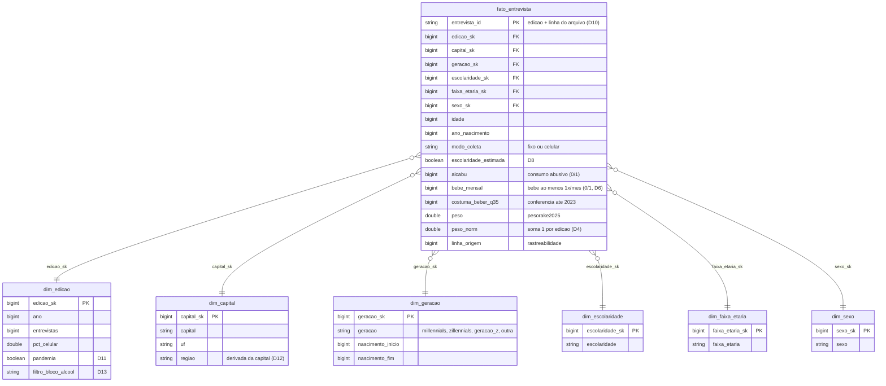

# Modelo estrela (camada gold)

Grão da fato: **uma entrevista do Vigitel**, edições de 2010 a 2024 (sem 2022), 615.877 linhas. As medidas são indicadores 0/1 (`alcabu`, `bebe_mensal`, `costuma_beber_q35`) e pesos; as prevalências são calculadas na análise como média ponderada pelo `peso_norm` (D4), e não guardadas na fato.

**Por que estrela:** as cinco perguntas cortam o mesmo fato (a entrevista) por geração, escolaridade, sexo, faixa etária, capital/região e edição. Cada corte é uma dimensão; nenhuma pergunta precisa de outra tabela de fatos.

**Camadas:**

| Camada | Tabela | Conteúdo |
|---|---|---|
| raw (Volume) | `vigitel-2006-2024-peso-rake-csv.zip` | arquivo oficial, conferido pelo SHA-256 |
| bronze | `bronze_vigitel`, `bronze_coleta_log` | cópia fiel do CSV (486 colunas, texto) + linha de origem; log da coleta |
| silver | `silver_vigitel` | 2010 em diante, 28 colunas, regras S1 a S11 (decisões D1 a D13); sem texto livre (D12) |
| gold | `fato_entrevista` + 6 dimensões | modelo estrela |
| qualidade | `qa_checagens`, `qa_perfil_atributos`, `qa_cobertura` | notebook 04 |
| resultados | `res_*` | P1 a P5, sensibilidades e veredito (notebook 05) |
